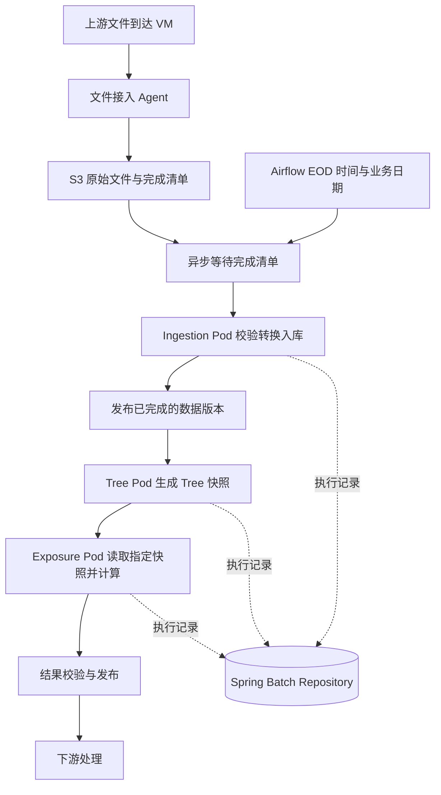

# Spring Batch / Control-M 向 Airflow / Kubernetes 迁移方案

日期：2026-10-27（Asia/Shanghai）

状态：架构可行性评估与 POC 设计；尚未实现或执行 POC，未通过生产容量验证。

适用场景：EOD 批处理、大量上下游依赖、每天上千次 job 执行、受限的 Kubernetes namespace 配额。

## 1. 问题与初步结论

现有系统由 Control-M 调度部署在 VM 上的旧版 Spring Batch，通过 Java 入口启动。Job、Step、Bean 及参数大量使用 XML / properties 文件配置。典型链路为等待文件、搬运文件、转换入库、加载 Tree、计算 Exposure、触发下游。

目标是升级 Spring Batch，按业务 domain 组织代码仓库和镜像，用 Airflow 编排，在 Kubernetes 中按需运行。

初步判断：架构有条件可行。上线前必须证明，在 EOD 时间窗口和配额内能够完成计算，故障后能够准确恢复，运维人员能够定位等待和失败原因。每天上千个 job 本身不能证明容量是否足够。

关键建议：

- Airflow 负责调度与跨 domain 依赖；Spring Batch 负责业务步骤、事务与检查点；Kubernetes 提供执行资源。
- Batch 采用运行一次后退出的容器程序，不必全部改造成常驻 HTTP microservice。
- 等待文件使用异步 Sensor，不反复创建 Java Pod。
- 通过固定版本的数据快照连接 domain；配置、输入和镜像版本均可追溯。
- 节点镜像缓存用于加速；生产镜像保留及独立供应路径用于故障保障。
- 先做一条完整业务链路的 POC，再扩展范围。

## 2. 端到端流程



Wait 从业务计算中分离。Airflow 的 deferrable S3 Sensor 在等待时释放 worker 执行槽，由 triggerer 异步检查；仍需要规划 triggerer 容量、轮询间隔和存储请求量。[S3 Sensor 官方文档](https://airflow.apache.org/docs/apache-airflow-providers-amazon/stable/operators/s3/s3.html)

Load 和 Transfer 如果共享重跑边界、没有独立消费者，也不需要分别扩缩容，可以合并成同一个 Spring Batch Job 的多个 Step。昂贵的下载或转换应保存可复用中间结果；跨 Pod 重启时不能依赖原 Pod 临时磁盘仍然存在。

## 3. VM 文件接入

过渡期在 VM 保留轻量文件接入 Agent。优先复用受支持的文件传输工具，也可以实现常驻进程或定时同步程序，不必先建设完整微服务。

建议 VM 主动上传，Airflow 等待就绪：

1. 通过上游完成标记或原子重命名协议确认文件写入结束。
2. 上传到包含业务日期、来源及文件版本的 S3 路径。
3. 校验大小、checksum 等信息。
4. 最后发布 manifest，列出该批全部文件、对象版本和校验值。
5. 持久化传输状态，支持重试、重启后的补扫与对账。

仅看到某个文件存在，不代表整批文件完整。文件大小短时间不变化也不是可靠的生产完成协议。

如业务必须按需触发上传，可由 Airflow 请求 VM 服务，再异步查询持久化状态。此方式需要额外处理服务不可用、重复请求、请求成功但响应丢失等情况。

## 4. 调度能力、并发与运维支持模型

Control-M 有 Resource Pools（原 Quantitative Resources），可以限制应用并发或数据库连接消耗；Lock Resources 可表达共享与独占资源。不能假设所有部署具有统一的最大并发数，应检查实际版本、配置、基础设施和合同。[BMC Resource Pools](https://documents.bmc.com/supportu/9.0.21.000/en-US/Documentation/Resource_Pools.htm)、[BMC Job Resources](https://docs.bmc.com/xwiki/bin/view/Control-M-Orchestration/Control-M/workloadautomation/Control-M-Automation-API/ctmapi9211/Code-Reference/Job-Properties/)

| 需求 | 新方案 |
|---|---|
| 定时与前后置依赖 | Airflow DAG、schedule、任务依赖 |
| 某类任务并发上限 | Pool 和 pool_slots |
| 多个业务日期是否允许重叠 | max_active_runs 与业务日期规则 |
| DAG 运行任务数 | max_active_tasks；以选定版本语义为准 |
| CPU、内存、Pod 数上限 | Kubernetes requests/limits、ResourceQuota |
| 同一业务对象只能有一个计算者 | 数据库唯一约束、业务锁或租约 |
| 节假日、迟到、补跑、人工放行 | 显式定义迁移规则并逐项验证 |

Airflow 还受执行器、全局配置、scheduler 和元数据库吞吐影响。不能仅提高某个并发参数就视为容量扩展。

一个 Airflow task 通常关联一个 Pool，不能直接等价于同时持有多个 Control-M 资源池和锁。复杂多资源约束需要组合预算或业务锁设计。[Airflow Pools](https://airflow.apache.org/docs/apache-airflow/stable/administration-and-deployment/pools.html)

特别注意：deferrable KubernetesPodOperator 等待期间，业务 Pod 仍在运行。控制业务并发的 Pool 应将 deferred task 计入占用，防止槽位释放后继续创建更多 Pod。文件等待使用独立策略。[Airflow deferral 机制](https://github.com/apache/airflow/blob/main/airflow-core/docs/authoring-and-scheduling/deferring.rst)

| 责任方 | 职责 |
|---|---|
| Batch 应用团队 | 业务结果、幂等、重启、数据对账 |
| Airflow 平台团队 | scheduler、triggerer、执行器、元数据库、升级 |
| Kubernetes 平台团队 | 节点、配额、网络、调度、镜像拉取 |
| 数据与存储团队 | PostgreSQL、S3、备份恢复 |
| 一线支持 | 识别等待原因、按操作手册重跑、升级处理 |

自建开源 Airflow 的商业支持、值班响应、备份恢复、升级维护需要另行落实，不能默认继承原 Control-M 厂商支持。迁移清单还应包含时区、业务日历、跨午夜业务日期、条件依赖、告警、权限、审计、人工操作和历史保留。

## 5. Spring Batch 执行模型与升级

推荐一次启动执行一个指定 Job，完成后退出。例如运行参数：

```text
jobName=calculateExposure
businessDate=2026-10-26
inputVersion=tree-snapshot-123
configVersion=exposure-config-17
```

流程为读取固定版本配置、校验输入、运行 Job / Steps、保存结果与状态、返回明确退出码。失败必须映射为容器非零退出码，不能业务失败而 Airflow 显示成功。

POC 可使用 KubernetesPodOperator 创建并监测 Pod；该 operator 不要求 Airflow 使用 KubernetesExecutor。[官方说明](https://airflow.apache.org/docs/apache-airflow-providers-cncf-kubernetes/10.21.0/operators.html)

后续如选择 KubernetesJobOperator，应明确 Kubernetes Job 重试与 Airflow 重试各自职责，避免两层自动重试意外放大执行次数。POC 首先选定一种执行模型。

XML 可逐步迁到 Java 配置，将 Job、Step、Reader、Processor、Writer 放入版本管理；环境配置继续外置。无需在首次迁移中重写所有 XML。

升级前核对 JDK、Spring Boot / Framework、Batch API、元数据库 schema、ExecutionContext 序列化和旧执行记录的恢复兼容性。不要只替换依赖版本。Spring Batch 6 有 API、基础设施和数据库变化，具体目标版本须按企业支持矩阵锁定。[Spring Batch 6 迁移指南](https://github.com/spring-projects/spring-batch/wiki/Spring-Batch-6.0-Migration-Guide)

需要持久化恢复时，显式配置 JDBC JobRepository 并验证所选版本行为，不依赖未经核实的默认配置。

## 6. 配置、状态与数据分工

| 信息 | 建议位置 |
|---|---|
| Job / Step 定义和业务代码 | Git 与容器镜像 |
| 环境地址、日志级别、技术参数 | 版本化 ConfigMap |
| 密码与凭据 | 企业 Secret 管理系统或 Kubernetes Secret |
| 本次业务日期、输入版本、配置版本 | Airflow 传入的运行参数 |
| 可审批、可审计的动态业务规则 | 版本化数据库配置 |
| Job / Step 执行、检查点 | PostgreSQL JDBC JobRepository |
| DAG / Task 调度状态 | Airflow metadata database |
| 文件已接收、数据已发布、业务完成 | 业务控制表 |
| 原始文件、中间数据、结果快照 | S3 或业务数据存储 |

ConfigMap 与数据库各司其职，不是二选一。一次运行应固定配置快照，避免中途修改造成前后步骤使用不同规则。

Spring Batch Repository 保存框架执行记录，不能替代全部业务完成状态。[JobRepository 官方文档](https://docs.spring.io/spring-batch/reference/job/configuring-repository.html)

可以共用部分 PostgreSQL 基础设施，但应分库或 schema、分权限，评估连接与故障影响。各 domain 不必共用同一套 Batch 元数据表，Airflow 元数据库也不应直接充当业务状态库。

每次执行记录实际 image digest、配置版本、输入版本以及业务日期，以支持审计和重放。

## 7. Domain、仓库、镜像与 DAG

- Repo：代码与团队维护边界。
- 镜像：发布产物，可包含同一 domain 的多个 batch job。
- Pod：某次执行实例。
- DAG：跨 domain 的业务流程。

四者不要求一一对应。建议 POC 使用一个 EOD DAG：

```text
ingestion image → 发布 inputVersion
tree image      → 使用 inputVersion，发布 treeSnapshotId
exposure image  → 使用 treeSnapshotId，发布 exposureRunId
downstream      → 使用已发布的 exposureRunId
```

下游只能读取明确发布完成的指定版本。不要读取“最新 Tree”，否则历史补跑可能误读其他业务日期数据。

大数据通过 S3 或数据库交接；Airflow 只传递地址、版本号和少量统计信息。各 domain 确实需要独立调度或复用时，再拆分为多个 DAG，并明确跨 DAG 成功条件、业务日期映射和超时。

## 8. 重试、恢复与业务幂等

区分三类操作：

- Retry：同一输入失败后的恢复。
- Replay：使用固定历史输入重新生成结果。
- Correction：修正输入或规则后生成新版本。

幂等标识可包含 jobName、businessDate、inputVersion 等业务字段，具体组合由业务粒度确定。Airflow retry 次数不应自动成为新的业务输入身份。

必须验证“数据已提交，但成功状态回传前 Pod 退出”：重试不能重复入库或重复计算。数据库唯一约束、幂等写入、staging 与发布标记共同保障结果；平台组合本身不提供端到端 exactly-once。

强制终止可能留下未结束的 Batch 执行记录。恢复前确认原执行已停止，再按受控流程处理状态，防止双重执行。定义超时、取消、租约失效、孤儿 Pod 检查和人工恢复操作手册。

## 9. 启动延迟与容量

```text
总耗时 = Airflow 排队 + Pod 创建与调度 + 镜像检查/拉取
       + 容器与 JVM 启动 + 数据读取 + 业务处理 + 状态回传
```

VM 原方案也有 JVM 启动成本，不能把新方案全部启动时间都归因于 Kubernetes。

分别测量已缓存镜像、未缓存镜像、新节点、EOD 集中启动、多段串行短任务，记录 P50 / P95 / P99 及关键路径。较短且紧密关联的步骤可合并，较长计算适合独立 Pod；判断依据是实际测量。

仅作容量计算示例：1,000 个任务，每个平均占用资源 5 分钟，120 分钟内完成，忽略依赖和额外开销时平均需要约 42 个执行槽（1000 × 5 / 120）。这不是容量承诺，尚未包含峰值、启动、失败重试、资源碎片与上下游等待。

最长串行关键路径超过窗口时，单纯增加并发无效。容量规划还应包含任务资源分布、CPU / 内存 requests 和 limits、临时磁盘、网络、存储吞吐、数据库连接、API 负载与 Airflow 元数据库。

ResourceQuota 是上限约束，不是资源预留：超过 quota 的创建请求可能被拒绝；quota 足够但节点不够，Pod 可能 Pending。[Kubernetes ResourceQuota](https://kubernetes.io/docs/concepts/policy/resource-quotas/)

以 Airflow 前置限流、Kubernetes 配额最终保护。为重试及关键任务留余量，合理划分小型导入与大型计算资源档位。50 个 Pod 每个允许 10 个 DB 连接，理论连接需求可能达到 500，需纳入预算。

## 10. Nexus、镜像版本与缓存

区分 Helm 资源定义、镜像仓库 / 代理缓存、节点容器运行时缓存。Helm Chart 本身不提供镜像缓存。

DAG 固定不可变 image digest，避免可覆盖 tag 引起版本漂移。IfNotPresent 可在节点已有镜像时使用本地副本，但节点更换、镜像垃圾回收、调度到其他节点及集群认证策略均需考虑。缓存不能保证旧版本长期存在。[Kubernetes Images](https://kubernetes.io/docs/concepts/containers/images/)、[Garbage Collection](https://kubernetes.io/docs/concepts/architecture/garbage-collection/)

| 层次 | 做法 | 作用 |
|---|---|---|
| 发布保障 | 保留仍被 DAG、回滚或历史重跑计划引用的 digest | 历史版本可获取 |
| 故障隔离 | 发布时复制完整镜像到独立可用的生产仓库 | 构建侧 Nexus 不可用时继续供应 |
| 性能优化 | EOD 前在目标节点预拉取所需镜像 | 减少启动延迟与集中拉取 |

仅配置需回源 Nexus 的代理不能保证故障隔离。主备镜像地址切换、镜像认证和准入策略需明确实现，不能假设 Kubernetes 自动尝试备用地址。运行期也不应从 Nexus 临时下载应用 JAR 或依赖。

缓存容量取决于磁盘、共享镜像层、回收阈值、版本数量和保留策略，没有统一保留时长。关键验收是“Nexus 故障且新节点没有缓存时，指定历史版本仍可运行”。

## 11. 日志与监控

应用输出结构化 stdout / stderr，平台统一采集到 Loki，Grafana 查询；不必每个 batch Pod 单独启动日志服务。可使用平台已有 Alloy 等采集组件。[Grafana Kubernetes 日志采集](https://grafana.com/docs/grafana-cloud/send-data/alloy/collect/logs-in-kubernetes/)

日志关联字段：businessDate、domain、jobName、dagRunId、jobExecutionId、inputVersion、imageDigest。运行 ID 放日志和执行表，避免全部作为 Prometheus 高基数 labels。

短任务可能在 Prometheus 两次 scrape 间结束。最终结果应以持久化执行记录为依据；服务级 batch 结果确需 Pushgateway 时，设计旧指标清理与可用性。[Prometheus Pushgateway 使用建议](https://prometheus.io/docs/practices/pushing/)

监控重点：EOD 完成时间、剩余关键路径、文件迟到、排队 / 启动 / 处理耗时、输入输出拒绝记录数、重试、Pending、OOM、镜像拉取失败、DB 连接、存储吞吐与 namespace 资源。验证 Pod 删除后日志仍可检索。

## 12. POC 范围与验收

实现一条代表性链路：VM 文件接入 → S3 manifest → Airflow 等待 → Spring Batch 入库 → Tree → Exposure → 结果对账。

| 场景 | 验收重点 |
|---|---|
| 正常运行 | 与旧系统记录数及 Exposure 等业务结果对账 |
| 重复、迟到、不完整文件 | 不重复处理、不提前计算、超时明确 |
| Pod 中途退出 | 可恢复，无重复或半发布结果 |
| Airflow 重启 | 已运行 Pod 可追踪，无意外重复执行 |
| 写入成功但回传失败 | 重试后业务结果仍唯一 |
| 配额达到上限 | 有界排队或退避，无重试风暴 |
| Nexus 故障与无缓存节点 | 独立镜像供应路径有效 |
| 多个镜像版本并存 | DAG 使用指定版本 |
| 历史业务日期补跑 | 输入、配置、结果版本正确 |
| EOD 峰值回放 | 整体与关键路径满足时间窗口 |

执行前约定 P95 启动时间、EOD 窗口、最大并发、恢复时限、数据库负载与业务对账标准。当前没有实测数据，不填写虚构通过值。

## 13. 使用步骤与实施顺序

1. 收集当前 Spring Batch / JDK 版本、一条 Control-M 实际链路、运行耗时及峰值并发、namespace 配额和 EOD deadline。
2. 盘点业务日历、资源锁、依赖、重跑语义和当前人工支持流程。
3. 固定 POC 技术版本及数据契约，选择代表性正常、异常与峰值输入。
4. 分步验证框架升级、容器运行、Airflow 编排，然后扩展 domain 拆分。
5. 用同一输入对照新旧系统结果，再实施故障注入与容量回放。
6. 明确生产运行手册、责任人、恢复与回滚方案；切换时只有一个调度路径负责生产写入。

## 14. 相关文件与验证边界

- 本文件：方案、设计决策、POC 验收清单及官方参考链接。
- [仓库首页](../../README.md)：方案索引与获取方式。
- 本次未提供可运行 DAG、Java 项目、Helm Chart 或数据库迁移脚本；后续实现可放入本目录并更新说明。

本方案基于讨论场景和官方机制文档整理，未访问真实 Control-M 配置、Kubernetes 集群、Nexus、业务数据库或生产文件，也未执行性能与故障测试。官方 stable 文档会更新，实施时应锁定软件版本并复核具体参数。容量、支持合同、镜像保留、网络访问和数据治理策略均待环境验证。
