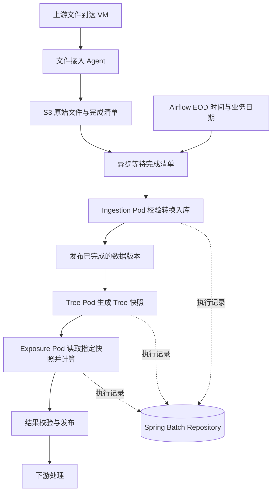
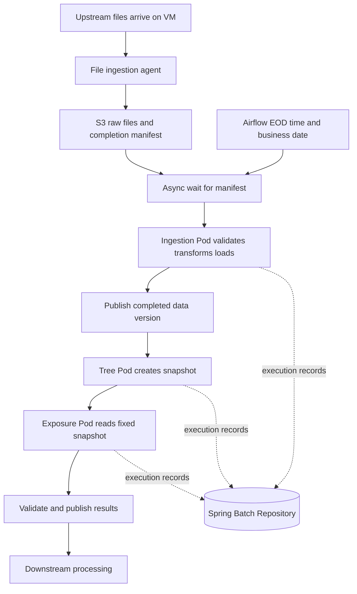

[中文](#zh) | [English](#en)

<a id="zh"></a>

# Spring Batch / Control-M 向 Airflow / Kubernetes 迁移方案

日期：2026-10-27（Asia/Shanghai）

状态：架构可行性评估与 POC 设计；尚未实现或执行 POC，未通过生产容量验证。

适用场景：EOD 批处理、大量上下游依赖、每天上千次 job 执行、受限的 Kubernetes namespace 配额。

## 1. 问题与初步结论

现有系统由 Control-M 调度部署在 VM 上的旧版 Spring Batch，通过 Java 入口启动。Job、Step、Bean 及参数大量使用 XML / properties 文件配置。典型链路为等待文件、搬运文件、转换入库、加载 Tree、计算 Exposure、触发下游。

目标是升级 Spring Batch，按业务 domain 组织代码仓库和镜像，用 Airflow 编排，在 Kubernetes 中按需运行。

初步判断：架构有条件可行。上线前必须证明，在 EOD 时间窗口和配额内能够完成计算，故障后能够准确恢复，运维人员能够定位等待和失败原因。每天上千个 job 本身不能证明容量是否足够。

关键建议：

- Airflow 负责调度与跨 domain 依赖；Spring Batch 负责业务步骤、事务与检查点；Kubernetes 提供执行资源。
- Batch 采用运行一次后退出的容器程序，不必全部改造成常驻 HTTP microservice。
- 等待文件使用异步 Sensor，不反复创建 Java Pod。
- 通过固定版本的数据快照连接 domain；配置、输入和镜像版本均可追溯。
- 节点镜像缓存用于加速；生产镜像保留及独立供应路径用于故障保障。
- 先做一条完整业务链路的 POC，再扩展范围。

## 2. 端到端流程



Wait 从业务计算中分离。Airflow 的 deferrable S3 Sensor 在等待时释放 worker 执行槽，由 triggerer 异步检查；仍需要规划 triggerer 容量、轮询间隔和存储请求量。[S3 Sensor 官方文档](https://airflow.apache.org/docs/apache-airflow-providers-amazon/stable/operators/s3/s3.html)

Load 和 Transfer 如果共享重跑边界、没有独立消费者，也不需要分别扩缩容，可以合并成同一个 Spring Batch Job 的多个 Step。昂贵的下载或转换应保存可复用中间结果；跨 Pod 重启时不能依赖原 Pod 临时磁盘仍然存在。

## 3. VM 文件接入

过渡期在 VM 保留轻量文件接入 Agent。优先复用受支持的文件传输工具，也可以实现常驻进程或定时同步程序，不必先建设完整微服务。

建议 VM 主动上传，Airflow 等待就绪：

1. 通过上游完成标记或原子重命名协议确认文件写入结束。
2. 上传到包含业务日期、来源及文件版本的 S3 路径。
3. 校验大小、checksum 等信息。
4. 最后发布 manifest，列出该批全部文件、对象版本和校验值。
5. 持久化传输状态，支持重试、重启后的补扫与对账。

仅看到某个文件存在，不代表整批文件完整。文件大小短时间不变化也不是可靠的生产完成协议。

如业务必须按需触发上传，可由 Airflow 请求 VM 服务，再异步查询持久化状态。此方式需要额外处理服务不可用、重复请求、请求成功但响应丢失等情况。

## 4. 调度能力、并发与运维支持模型

Control-M 有 Resource Pools（原 Quantitative Resources），可以限制应用并发或数据库连接消耗；Lock Resources 可表达共享与独占资源。不能假设所有部署具有统一的最大并发数，应检查实际版本、配置、基础设施和合同。[BMC Resource Pools](https://documents.bmc.com/supportu/9.0.21.000/en-US/Documentation/Resource_Pools.htm)、[BMC Job Resources](https://docs.bmc.com/xwiki/bin/view/Control-M-Orchestration/Control-M/workloadautomation/Control-M-Automation-API/ctmapi9211/Code-Reference/Job-Properties/)

| 需求 | 新方案 |
|---|---|
| 定时与前后置依赖 | Airflow DAG、schedule、任务依赖 |
| 某类任务并发上限 | Pool 和 pool_slots |
| 多个业务日期是否允许重叠 | max_active_runs 与业务日期规则 |
| DAG 运行任务数 | max_active_tasks；以选定版本语义为准 |
| CPU、内存、Pod 数上限 | Kubernetes requests/limits、ResourceQuota |
| 同一业务对象只能有一个计算者 | 数据库唯一约束、业务锁或租约 |
| 节假日、迟到、补跑、人工放行 | 显式定义迁移规则并逐项验证 |

Airflow 还受执行器、全局配置、scheduler 和元数据库吞吐影响。不能仅提高某个并发参数就视为容量扩展。

一个 Airflow task 通常关联一个 Pool，不能直接等价于同时持有多个 Control-M 资源池和锁。复杂多资源约束需要组合预算或业务锁设计。[Airflow Pools](https://airflow.apache.org/docs/apache-airflow/stable/administration-and-deployment/pools.html)

特别注意：deferrable KubernetesPodOperator 等待期间，业务 Pod 仍在运行。控制业务并发的 Pool 应将 deferred task 计入占用，防止槽位释放后继续创建更多 Pod。文件等待使用独立策略。[Airflow deferral 机制](https://github.com/apache/airflow/blob/main/airflow-core/docs/authoring-and-scheduling/deferring.rst)

| 责任方 | 职责 |
|---|---|
| Batch 应用团队 | 业务结果、幂等、重启、数据对账 |
| Airflow 平台团队 | scheduler、triggerer、执行器、元数据库、升级 |
| Kubernetes 平台团队 | 节点、配额、网络、调度、镜像拉取 |
| 数据与存储团队 | PostgreSQL、S3、备份恢复 |
| 一线支持 | 识别等待原因、按操作手册重跑、升级处理 |

自建开源 Airflow 的商业支持、值班响应、备份恢复、升级维护需要另行落实，不能默认继承原 Control-M 厂商支持。迁移清单还应包含时区、业务日历、跨午夜业务日期、条件依赖、告警、权限、审计、人工操作和历史保留。

## 5. Spring Batch 执行模型与升级

推荐一次启动执行一个指定 Job，完成后退出。例如运行参数：

```text
jobName=calculateExposure
businessDate=2026-10-26
inputVersion=tree-snapshot-123
configVersion=exposure-config-17
```

流程为读取固定版本配置、校验输入、运行 Job / Steps、保存结果与状态、返回明确退出码。失败必须映射为容器非零退出码，不能业务失败而 Airflow 显示成功。

POC 可使用 KubernetesPodOperator 创建并监测 Pod；该 operator 不要求 Airflow 使用 KubernetesExecutor。[官方说明](https://airflow.apache.org/docs/apache-airflow-providers-cncf-kubernetes/10.21.0/operators.html)

后续如选择 KubernetesJobOperator，应明确 Kubernetes Job 重试与 Airflow 重试各自职责，避免两层自动重试意外放大执行次数。POC 首先选定一种执行模型。

XML 可逐步迁到 Java 配置，将 Job、Step、Reader、Processor、Writer 放入版本管理；环境配置继续外置。无需在首次迁移中重写所有 XML。

升级前核对 JDK、Spring Boot / Framework、Batch API、元数据库 schema、ExecutionContext 序列化和旧执行记录的恢复兼容性。不要只替换依赖版本。Spring Batch 6 有 API、基础设施和数据库变化，具体目标版本须按企业支持矩阵锁定。[Spring Batch 6 迁移指南](https://github.com/spring-projects/spring-batch/wiki/Spring-Batch-6.0-Migration-Guide)

需要持久化恢复时，显式配置 JDBC JobRepository 并验证所选版本行为，不依赖未经核实的默认配置。

## 6. 配置、状态与数据分工

| 信息 | 建议位置 |
|---|---|
| Job / Step 定义和业务代码 | Git 与容器镜像 |
| 环境地址、日志级别、技术参数 | 版本化 ConfigMap |
| 密码与凭据 | 企业 Secret 管理系统或 Kubernetes Secret |
| 本次业务日期、输入版本、配置版本 | Airflow 传入的运行参数 |
| 可审批、可审计的动态业务规则 | 版本化数据库配置 |
| Job / Step 执行、检查点 | PostgreSQL JDBC JobRepository |
| DAG / Task 调度状态 | Airflow metadata database |
| 文件已接收、数据已发布、业务完成 | 业务控制表 |
| 原始文件、中间数据、结果快照 | S3 或业务数据存储 |

ConfigMap 与数据库各司其职，不是二选一。一次运行应固定配置快照，避免中途修改造成前后步骤使用不同规则。

Spring Batch Repository 保存框架执行记录，不能替代全部业务完成状态。[JobRepository 官方文档](https://docs.spring.io/spring-batch/reference/job/configuring-repository.html)

可以共用部分 PostgreSQL 基础设施，但应分库或 schema、分权限，评估连接与故障影响。各 domain 不必共用同一套 Batch 元数据表，Airflow 元数据库也不应直接充当业务状态库。

每次执行记录实际 image digest、配置版本、输入版本以及业务日期，以支持审计和重放。

## 7. Domain、仓库、镜像与 DAG

- Repo：代码与团队维护边界。
- 镜像：发布产物，可包含同一 domain 的多个 batch job。
- Pod：某次执行实例。
- DAG：跨 domain 的业务流程。

四者不要求一一对应。建议 POC 使用一个 EOD DAG：

```text
ingestion image → 发布 inputVersion
tree image      → 使用 inputVersion，发布 treeSnapshotId
exposure image  → 使用 treeSnapshotId，发布 exposureRunId
downstream      → 使用已发布的 exposureRunId
```

下游只能读取明确发布完成的指定版本。不要读取“最新 Tree”，否则历史补跑可能误读其他业务日期数据。

大数据通过 S3 或数据库交接；Airflow 只传递地址、版本号和少量统计信息。各 domain 确实需要独立调度或复用时，再拆分为多个 DAG，并明确跨 DAG 成功条件、业务日期映射和超时。

## 8. 重试、恢复与业务幂等

区分三类操作：

- Retry：同一输入失败后的恢复。
- Replay：使用固定历史输入重新生成结果。
- Correction：修正输入或规则后生成新版本。

幂等标识可包含 jobName、businessDate、inputVersion 等业务字段，具体组合由业务粒度确定。Airflow retry 次数不应自动成为新的业务输入身份。

必须验证“数据已提交，但成功状态回传前 Pod 退出”：重试不能重复入库或重复计算。数据库唯一约束、幂等写入、staging 与发布标记共同保障结果；平台组合本身不提供端到端 exactly-once。

强制终止可能留下未结束的 Batch 执行记录。恢复前确认原执行已停止，再按受控流程处理状态，防止双重执行。定义超时、取消、租约失效、孤儿 Pod 检查和人工恢复操作手册。

## 9. 启动延迟与容量

```text
总耗时 = Airflow 排队 + Pod 创建与调度 + 镜像检查/拉取
       + 容器与 JVM 启动 + 数据读取 + 业务处理 + 状态回传
```

VM 原方案也有 JVM 启动成本，不能把新方案全部启动时间都归因于 Kubernetes。

分别测量已缓存镜像、未缓存镜像、新节点、EOD 集中启动、多段串行短任务，记录 P50 / P95 / P99 及关键路径。较短且紧密关联的步骤可合并，较长计算适合独立 Pod；判断依据是实际测量。

仅作容量计算示例：1,000 个任务，每个平均占用资源 5 分钟，120 分钟内完成，忽略依赖和额外开销时平均需要约 42 个执行槽（1000 × 5 / 120）。这不是容量承诺，尚未包含峰值、启动、失败重试、资源碎片与上下游等待。

最长串行关键路径超过窗口时，单纯增加并发无效。容量规划还应包含任务资源分布、CPU / 内存 requests 和 limits、临时磁盘、网络、存储吞吐、数据库连接、API 负载与 Airflow 元数据库。

ResourceQuota 是上限约束，不是资源预留：超过 quota 的创建请求可能被拒绝；quota 足够但节点不够，Pod 可能 Pending。[Kubernetes ResourceQuota](https://kubernetes.io/docs/concepts/policy/resource-quotas/)

以 Airflow 前置限流、Kubernetes 配额最终保护。为重试及关键任务留余量，合理划分小型导入与大型计算资源档位。50 个 Pod 每个允许 10 个 DB 连接，理论连接需求可能达到 500，需纳入预算。

## 10. Nexus、镜像版本与缓存

区分 Helm 资源定义、镜像仓库 / 代理缓存、节点容器运行时缓存。Helm Chart 本身不提供镜像缓存。

DAG 固定不可变 image digest，避免可覆盖 tag 引起版本漂移。IfNotPresent 可在节点已有镜像时使用本地副本，但节点更换、镜像垃圾回收、调度到其他节点及集群认证策略均需考虑。缓存不能保证旧版本长期存在。[Kubernetes Images](https://kubernetes.io/docs/concepts/containers/images/)、[Garbage Collection](https://kubernetes.io/docs/concepts/architecture/garbage-collection/)

| 层次 | 做法 | 作用 |
|---|---|---|
| 发布保障 | 保留仍被 DAG、回滚或历史重跑计划引用的 digest | 历史版本可获取 |
| 故障隔离 | 发布时复制完整镜像到独立可用的生产仓库 | 构建侧 Nexus 不可用时继续供应 |
| 性能优化 | EOD 前在目标节点预拉取所需镜像 | 减少启动延迟与集中拉取 |

仅配置需回源 Nexus 的代理不能保证故障隔离。主备镜像地址切换、镜像认证和准入策略需明确实现，不能假设 Kubernetes 自动尝试备用地址。运行期也不应从 Nexus 临时下载应用 JAR 或依赖。

缓存容量取决于磁盘、共享镜像层、回收阈值、版本数量和保留策略，没有统一保留时长。关键验收是“Nexus 故障且新节点没有缓存时，指定历史版本仍可运行”。

## 11. 日志与监控

应用输出结构化 stdout / stderr，平台统一采集到 Loki，Grafana 查询；不必每个 batch Pod 单独启动日志服务。可使用平台已有 Alloy 等采集组件。[Grafana Kubernetes 日志采集](https://grafana.com/docs/grafana-cloud/send-data/alloy/collect/logs-in-kubernetes/)

日志关联字段：businessDate、domain、jobName、dagRunId、jobExecutionId、inputVersion、imageDigest。运行 ID 放日志和执行表，避免全部作为 Prometheus 高基数 labels。

短任务可能在 Prometheus 两次 scrape 间结束。最终结果应以持久化执行记录为依据；服务级 batch 结果确需 Pushgateway 时，设计旧指标清理与可用性。[Prometheus Pushgateway 使用建议](https://prometheus.io/docs/practices/pushing/)

监控重点：EOD 完成时间、剩余关键路径、文件迟到、排队 / 启动 / 处理耗时、输入输出拒绝记录数、重试、Pending、OOM、镜像拉取失败、DB 连接、存储吞吐与 namespace 资源。验证 Pod 删除后日志仍可检索。

## 12. POC 范围与验收

实现一条代表性链路：VM 文件接入 → S3 manifest → Airflow 等待 → Spring Batch 入库 → Tree → Exposure → 结果对账。

| 场景 | 验收重点 |
|---|---|
| 正常运行 | 与旧系统记录数及 Exposure 等业务结果对账 |
| 重复、迟到、不完整文件 | 不重复处理、不提前计算、超时明确 |
| Pod 中途退出 | 可恢复，无重复或半发布结果 |
| Airflow 重启 | 已运行 Pod 可追踪，无意外重复执行 |
| 写入成功但回传失败 | 重试后业务结果仍唯一 |
| 配额达到上限 | 有界排队或退避，无重试风暴 |
| Nexus 故障与无缓存节点 | 独立镜像供应路径有效 |
| 多个镜像版本并存 | DAG 使用指定版本 |
| 历史业务日期补跑 | 输入、配置、结果版本正确 |
| EOD 峰值回放 | 整体与关键路径满足时间窗口 |

执行前约定 P95 启动时间、EOD 窗口、最大并发、恢复时限、数据库负载与业务对账标准。当前没有实测数据，不填写虚构通过值。

## 13. 使用步骤与实施顺序

1. 收集当前 Spring Batch / JDK 版本、一条 Control-M 实际链路、运行耗时及峰值并发、namespace 配额和 EOD deadline。
2. 盘点业务日历、资源锁、依赖、重跑语义和当前人工支持流程。
3. 固定 POC 技术版本及数据契约，选择代表性正常、异常与峰值输入。
4. 分步验证框架升级、容器运行、Airflow 编排，然后扩展 domain 拆分。
5. 用同一输入对照新旧系统结果，再实施故障注入与容量回放。
6. 明确生产运行手册、责任人、恢复与回滚方案；切换时只有一个调度路径负责生产写入。

## 14. 相关文件与验证边界

- 本文件：方案、设计决策、POC 验收清单及官方参考链接。
- [仓库首页](../../README.md)：方案索引与获取方式。
- [本地 POC 部署文件与实测结果](poc/README.md)：2026-11-01 已完成 Airflow 安装，真实 Spring Batch Java 项目经 KubernetesPodOperator 运行成功，主动失败传播验证通过。包含源码、Chart、DAG、安装与验收脚本。
- 当前尚未接入生产文件、实现生产数据库迁移或完成 EOD 容量验证；原始架构评估的这些限制仍然适用。

原始架构评估基于讨论场景和官方机制文档整理，未访问生产 Control-M 配置、Kubernetes 集群、Nexus、业务数据库或文件，也未执行生产性能与故障测试。官方 stable 文档会更新，实施时应锁定软件版本并复核具体参数。容量、支持合同、镜像保留、网络访问和数据治理策略均待环境验证。

---

<a id="en"></a>

# Spring Batch / Control-M migration to Airflow / Kubernetes — English

Date: 2026-10-27 (Asia/Shanghai).

Original status: architecture feasibility assessment and POC design, without execution or production capacity validation at the time of writing. The [local POC results](poc/README.md#en) now document successful execution on 2026-11-01. Production validation remains outstanding.

Scope: EOD batch processing with many upstream/downstream dependencies, thousands of daily job executions, and restricted Kubernetes namespace quotas.

## 1. Problem and preliminary conclusion

The existing system uses Control-M to launch Java entry points for older Spring Batch applications deployed on VMs. XML and properties files define Jobs, Steps, Beans, and parameters. A typical chain waits for files, moves them, transforms and loads them into the database, loads a Tree, calculates Exposure, and triggers downstream work.

The target upgrades Spring Batch, organizes code and images by business domain, uses Airflow for orchestration, and runs work on demand in Kubernetes.

The architecture is conditionally feasible. Production acceptance requires evidence that the EOD deadline and quotas can be met, failures can be recovered accurately, and support staff can identify waiting and failure causes. Thousands of daily jobs alone do not establish capacity.

Recommendations:

- Airflow owns schedules and cross-domain dependencies; Spring Batch owns business steps, transactions, and checkpoints; Kubernetes supplies execution resources.
- Batch applications run once and exit; they do not all need permanent HTTP services.
- Use asynchronous Sensors for file waiting rather than repeatedly creating Java Pods.
- Connect domains using fixed data snapshots. Trace input, configuration, and image versions.
- Use node image caches for speed, and retained production images plus an independently available image supply for resilience.
- Start with one complete business chain before expanding scope.

## 2. End-to-end flow



Keep waiting separate from computation. A deferrable S3 Sensor releases worker execution slots while the triggerer checks asynchronously. Plan triggerer capacity, polling intervals, and storage request volume. [Official S3 Sensor documentation](https://airflow.apache.org/docs/apache-airflow-providers-amazon/stable/operators/s3/s3.html)

Load and Transfer can become multiple Steps in one Job when they share a recovery boundary, have no independent consumers, and do not need independent scaling. Persist expensive intermediate work for reuse. A replacement Pod cannot depend on the previous Pod's temporary disk surviving.

## 3. VM file ingestion

During transition, retain a lightweight file agent on the VM. Existing supported transfer tools, a persistent process, or scheduled synchronization may suffice.

Prefer VM-initiated upload and Airflow waiting:

1. Confirm completion using an upstream marker or atomic rename protocol.
2. Upload to an S3 path containing business date, source, and file version.
3. Verify size and checksum.
4. Publish the manifest last, listing every expected object version and checksum.
5. Persist transfer status for retries, restart reconciliation, and rescanning.

A file's existence does not establish batch completeness; briefly unchanged size is not a reliable production completion protocol.

If uploads must be initiated on demand, Airflow can request the VM service and query durable status asynchronously. Handle service outages, duplicate requests, and a successful request whose response is lost.

## 4. Scheduling, concurrency, and operational support

Control-M Resource Pools, formerly Quantitative Resources, constrain concurrency or database connection consumption; Lock Resources express shared/exclusive access. There is no universal concurrency number for every deployment: inspect the actual version, configuration, infrastructure, and contract. [BMC Resource Pools](https://documents.bmc.com/supportu/9.0.21.000/en-US/Documentation/Resource_Pools.htm), [BMC job resources](https://docs.bmc.com/xwiki/bin/view/Control-M-Orchestration/Control-M/workloadautomation/Control-M-Automation-API/ctmapi9211/Code-Reference/Job-Properties/)

| Need | Target mechanism |
|---|---|
| Schedules and predecessor dependencies | Airflow DAG, schedule, task dependencies |
| Concurrency for a workload class | Pool and pool_slots |
| Overlap between business dates | max_active_runs and explicit date rules |
| Running tasks within a DAG | max_active_tasks; verify the selected version's semantics |
| CPU, memory, Pod caps | Kubernetes requests/limits and ResourceQuota |
| One active processor per business object | Database uniqueness, business locks, or leases |
| Holidays, late files, backfills, manual release | Explicitly migrated and tested rules |

Executor capacity, global settings, scheduler throughput, and metadata database throughput also matter. Raising one parameter does not establish capacity.

A task generally belongs to one Airflow Pool; this is not equivalent to holding multiple Control-M pools and locks simultaneously. Complex constraints need combined resource budgets or business locks. [Airflow Pools](https://airflow.apache.org/docs/apache-airflow/stable/administration-and-deployment/pools.html)

A deferred KubernetesPodOperator can still have a running business Pod. Compute Pools must count deferred tasks to prevent oversubscription. File-waiting tasks can use a separate policy. [Deferral mechanics](https://github.com/apache/airflow/blob/main/airflow-core/docs/authoring-and-scheduling/deferring.rst)

| Owner | Responsibilities |
|---|---|
| Batch application team | Business correctness, idempotency, restart, reconciliation |
| Airflow platform team | Scheduler, triggerer, executor, metadata DB, upgrades |
| Kubernetes platform team | Nodes, quotas, networking, scheduling, image pulls |
| Data/storage team | PostgreSQL, S3, backup and recovery |
| First-line support | Identify waiting reasons, follow rerun runbooks, escalate |

Self-hosted open-source Airflow requires explicit commercial support, on-call coverage, backup/recovery, and maintenance arrangements. Existing Control-M vendor support does not automatically transfer. Include time zones, business calendars, dates crossing midnight, conditions, alerts, access control, audit, manual intervention, and historical retention in the migration inventory.

## 5. Spring Batch execution and upgrade

Run a selected Job once and exit. Example parameters:

```text
jobName=calculateExposure
businessDate=2026-10-26
inputVersion=tree-snapshot-123
configVersion=exposure-config-17
```

Read a fixed configuration version, validate inputs, execute Job/Steps, persist results and status, then return an explicit exit code. Business failures must produce a nonzero container exit code.

KubernetesPodOperator creates and monitors Pods without requiring KubernetesExecutor. [Official operator documentation](https://airflow.apache.org/docs/apache-airflow-providers-cncf-kubernetes/10.21.0/operators.html)

If KubernetesJobOperator is selected later, assign retry ownership between Airflow and Kubernetes Jobs to avoid multiplying attempts. Choose one execution model for the initial POC.

Move XML incrementally to Java configuration while externalizing environment settings. Rewriting every XML definition is unnecessary for the first migration.

Check JDK, Spring Boot/Framework, Batch APIs, metadata schema, ExecutionContext serialization, and compatibility with old execution records. Upgrading dependencies alone is insufficient. Spring Batch 6 changes APIs, infrastructure, and database structures; choose the target from the organization's support matrix. [Spring Batch 6 migration guide](https://github.com/spring-projects/spring-batch/wiki/Spring-Batch-6.0-Migration-Guide)

Explicitly configure a JDBC JobRepository when durable restart is required, and verify behavior for the selected version rather than assuming defaults.

## 6. Configuration, state, and data

| Information | Suggested location |
|---|---|
| Job/Step definitions and business code | Git and container image |
| Environment endpoints, log levels, technical settings | Versioned ConfigMap |
| Credentials | Enterprise secret manager or Kubernetes Secret |
| Business date, input version, configuration version | Airflow runtime parameters |
| Approved/auditable dynamic business rules | Versioned database configuration |
| Job/Step executions and checkpoints | PostgreSQL JDBC JobRepository |
| DAG/Task scheduling state | Airflow metadata database |
| File receipt, dataset publication, business completion | Business control tables |
| Raw files, intermediates, result snapshots | S3 or business storage |

ConfigMap and databases serve different purposes. Pin configuration for each run to prevent mid-run changes from producing inconsistent steps.

The Batch Repository holds framework execution records, not every business completion state. [JobRepository documentation](https://docs.spring.io/spring-batch/reference/job/configuring-repository.html)

Infrastructure may be shared locally, but separate databases/schemas and permissions and assess connections and failure impact. Domains need not share one Batch metadata schema. Do not use Airflow metadata as the business state database. Record image digest, configuration version, input version, and business date for every execution.

## 7. Domains, repositories, images, and DAGs

Repositories define code/team ownership; images are release artifacts and may contain several jobs for one domain; Pods are executions; DAGs define business workflows. They do not need one-to-one correspondence.

Start with one EOD DAG:

```text
ingestion image → publishes inputVersion
tree image      → consumes inputVersion, publishes treeSnapshotId
exposure image  → consumes treeSnapshotId, publishes exposureRunId
downstream      → consumes the published exposureRunId
```

Consumers must use explicitly published, fixed versions. Reading the “latest Tree” can mix dates during historical reruns. Exchange large data through storage; Airflow carries references, versions, and small statistics. Split DAGs only when independent scheduling or reuse justifies it, with explicit success conditions, business-date mapping, and timeouts.

## 8. Retry, recovery, and idempotency

Distinguish retry (recover the same input), replay (reproduce fixed historical input), and correction (publish a new version after changing inputs/rules).

Business identity may include jobName, businessDate, and inputVersion; choose fields according to business granularity. An Airflow attempt number should not automatically define a new business input.

Test a Pod dying after committing data but before reporting success. Retrying must not duplicate writes or calculations. Combine uniqueness constraints, idempotent writes, staging, and publication markers; these platforms do not automatically provide end-to-end exactly-once behavior.

Forced termination may leave unfinished Batch records. Confirm the old execution has stopped before controlled recovery. Define timeouts, cancellation, lease expiry, orphan Pod checks, and manual runbooks.

## 9. Startup latency and capacity

```text
Total = Airflow queueing + Pod creation/scheduling + image checks/pulls
      + container/JVM startup + input reads + business processing + status reporting
```

VM execution also starts a JVM, so not all new startup time is Kubernetes overhead. Measure cached/uncached images, new nodes, EOD bursts, and serial short tasks; record P50/P95/P99 and critical paths. Combine short tightly coupled steps based on measurements.

Illustration only: 1,000 tasks averaging five occupied minutes within 120 minutes require roughly 42 average execution slots (1000 × 5 / 120), before dependencies, peaks, startup, retries, fragmentation, or waiting. This is not a capacity guarantee. More concurrency cannot fix a serial critical path longer than the window.

Budget resource distributions, CPU/memory requests and limits, temporary disk, networking, storage throughput, database connections, Kubernetes API load, and Airflow metadata throughput.

ResourceQuota is an upper bound, not a reservation. Exceeding it can reject Pod creation; insufficient node resources can leave a Pod Pending even within quota. [ResourceQuota](https://kubernetes.io/docs/concepts/policy/resource-quotas/)

Throttle in Airflow, retain quota as final protection, reserve retry/critical-work headroom, and define small/large resource classes. Fifty Pods allowing ten database connections each can demand 500 connections.

## 10. Nexus, versions, and caches

Distinguish Helm definitions, registries/proxy caches, and node runtime caches. Helm does not itself cache images.

Pin immutable digests. IfNotPresent can reuse an image on the selected node, but node replacement, garbage collection, scheduling elsewhere, and image authorization policies can require registry access. Node caches do not guarantee historical retention. [Kubernetes images](https://kubernetes.io/docs/concepts/containers/images/), [garbage collection](https://kubernetes.io/docs/concepts/architecture/garbage-collection/)

| Layer | Approach | Purpose |
|---|---|---|
| Release retention | Retain digests referenced by DAGs, rollback plans, or historical replay | Keep historical images available |
| Fault isolation | Replicate complete images to an independently available production registry during release | Continue serving images during build-side Nexus outages |
| Performance | Pre-pull EOD images on target nodes | Reduce latency and pull bursts |

A proxy that still needs Nexus is not independent supply. Implement registry switching, authentication, and admission behavior explicitly; Kubernetes does not automatically try an arbitrary backup location. Avoid runtime JAR/dependency downloads from Nexus.

Cache capacity and retention depend on disk, shared layers, garbage-collection thresholds, version counts, and policies. Test a historical version on a new uncached node while Nexus is unavailable.

## 11. Logs and monitoring

Emit structured stdout/stderr and collect centrally into Loki for Grafana, using existing platform collectors such as Alloy rather than one logging service per batch Pod. [Grafana Kubernetes collection](https://grafana.com/docs/grafana-cloud/send-data/alloy/collect/logs-in-kubernetes/)

Correlate businessDate, domain, jobName, dagRunId, jobExecutionId, inputVersion, and imageDigest. Keep high-cardinality execution identities in logs/tables rather than every Prometheus label.

Short jobs may finish between scrapes. Use durable execution records for final outcomes; if Pushgateway is appropriate for service-level batch results, plan stale-series cleanup and availability. [Prometheus guidance](https://prometheus.io/docs/practices/pushing/)

Monitor EOD completion, remaining critical path, late files, queue/start/process duration, input/output/rejected counts, retries, Pending/OOM/pull failures, connections, storage throughput, and namespace resources. Verify logs remain accessible after Pod deletion.

## 12. POC acceptance

Representative target: VM ingestion → S3 manifest → Airflow wait → Batch database load → Tree → Exposure → reconciliation.

| Scenario | Acceptance focus |
|---|---|
| Normal execution | Reconcile record counts and Exposure with the old system |
| Duplicate, late, incomplete files | No duplicate processing or premature calculation; clear timeout |
| Pod termination | Recover without duplicates or partially published output |
| Airflow restart | Track existing Pods without unintended execution |
| Commit succeeds, reporting fails | Retry preserves unique business results |
| Quota exhausted | Bounded queueing/backoff; no retry storm |
| Nexus outage and uncached node | Independent image supply works |
| Multiple image versions | Each DAG uses its specified version |
| Historical date replay | Correct input/configuration/result versions |
| EOD peak replay | Overall window and critical path meet deadlines |

Agree P95 startup, EOD deadline, concurrency, recovery time, database load, and reconciliation criteria before testing. The original assessment had no measured values; do not invent acceptance results.

## 13. Implementation sequence

1. Collect Batch/JDK versions, a real Control-M chain, durations and peak concurrency, quotas, and EOD deadlines.
2. Inventory calendars, locks, dependencies, rerun semantics, and manual support procedures.
3. Pin POC versions and data contracts; select normal, failure, and peak inputs.
4. Validate framework upgrade, container execution, and Airflow orchestration incrementally, then expand domains.
5. Compare both systems on identical input, then inject failures and replay capacity.
6. Define ownership, runbooks, recovery, and rollback. Only one production scheduling path should own writes at cutover.

## 14. Files and verification boundaries

- This document: architecture, decisions, acceptance criteria, and official references.
- [Repository home](../../README.md#en): index and retrieval instructions.
- [Local POC and observed results](poc/README.md#en): as of 2026-11-01, Airflow runs a real Spring Batch Java application through KubernetesPodOperator; normal and intentional failure cases passed. Source, charts, DAGs, setup, and verification scripts are included.
- Production files, database migration, and EOD capacity validation remain outside the completed local POC.

The original architecture assessment was based on the described scenario and official mechanisms, without inspecting production Control-M, Kubernetes, Nexus, business databases, or files and without production performance/fault testing. Stable documentation changes: pin versions and recheck settings during implementation. Capacity, support contracts, retention, networking, and governance still require environment-specific validation.
