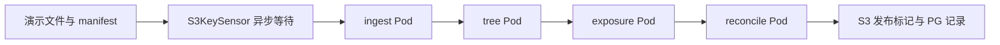
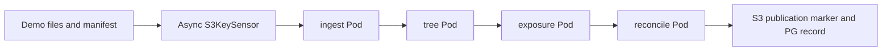

[中文](#zh) | [English](#en)

<a id="zh"></a>

# 本地 Kubernetes + Airflow EOD POC（进行中）

进度保存日期：2026-10-28（Asia/Shanghai）。用户要求先上传当前工作，后续继续安装与联调。

**当前状态：已完成部署文件与 DAG 初稿、静态检查；Airflow 尚未安装成功，DAG 尚未端到端运行。以下脚本仍需在集群恢复后联调。**

## 已完成的文件

| 路径 | 用途 |
|---|---|
| `airflow/values-local.yaml` | 官方 Airflow Chart 的本地配置：LocalExecutor、triggerer、DAG 挂载、资源请求和 Secret 引用 |
| `charts/eod-poc/` | 自定义 Helm Chart，部署 DAG ConfigMap、模拟处理脚本、domain 配置、RBAC、ResourceQuota、PostgreSQL、MinIO 与 PVC |
| `charts/eod-poc/files/eod_pipeline.py` | `eod_exposure_poc` DAG |
| `charts/eod-poc/files/worker.py` | 可操作 S3 / PostgreSQL 的模拟 domain 程序 |
| `scripts/Setup-Local.ps1` | 环境检查、Helm 下载校验、生成本地随机凭据、部署两个 release、创建 Pool、导入演示文件 |
| `scripts/Deploy-Dag.ps1` | 通过 Helm 更新 DAG 和相关业务配置 |
| `scripts/Seed-Demo.ps1` | 生成演示 CSV，上传后最后发布 manifest |
| `scripts/Open-Airflow.ps1` | 仅绑定 127.0.0.1 的 Airflow UI 端口转发 |
| `scripts/Common.ps1` | 路径、固定 context、局部代理排除、命令错误检查 |

## 设计



- `S3KeySensor(deferrable=True)` 等待明确业务日期和输入版本的 manifest。
- 四个处理阶段使用 `KubernetesPodOperator(deferrable=True)`，受 `eod_compute` Pool、Pod requests/limits 和 namespace quota 约束。
- `eod_compute` 计划设置 2 个槽，并将 deferred task 计入占用。
- domain 数据通过固定 S3 key 传递；运行参数包含业务日期、输入版本、配置版本。
- 模拟程序校验输入 checksum / 行数，使用 Decimal 计算演示值；PG 唯一键与事务级 advisory lock 防止同一身份并发写入不同结果。
- 无 XCom 数据副本，也不需要 XCom sidecar。
- DAG 默认手工触发，`catchup=False`、`max_active_runs=1`；尚未配置生产 EOD 日历。

这是一条编排与容器执行的演示。`worker.py` **不是 Spring Batch**，Exposure 公式和对账值仅是固定样例。实际 Java 应用、JDBC JobRepository、VM 接入 Agent、Loki / Prometheus 尚未实现或部署。

## 本机已确认的信息

- Windows 11，约 16 GB 物理内存。
- Docker Desktop 4.49.0 / Docker Engine 28.5.1 已安装。
- 已有 `docker-desktop` Kubernetes context；节点版本 v1.34.1。
- 容器引擎已恢复启动，报告可用内存约 7.9 GB。
- 已下载并核验 Helm v3.19.0，工具存放于仓库根目录 `.local/tools/helm/windows-amd64/helm.exe`。
- 官方 Airflow Chart 锁定 1.22.0，Airflow 镜像锁定 `apache/airflow:3.2.2`。
- PostgreSQL 镜像为 `postgres:16.6-alpine`；MinIO 镜像为 `minio/minio:RELEASE.2025-04-22T22-12-26Z`。镜像下载未全部完成。

## 当前阻塞与诊断记录

1. Docker 最初因残留通信文件 `Docker/run/dockerInference` 与 `docker-secrets-engine/engine.sock` 无法启动。对应临时目录已改名备份，未删除容器、镜像或磁盘数据；容器引擎随后恢复。
2. 本机存在网络代理。Kubernetes 内部请求曾错误地发往代理，kubelet 报 `proxyconnect` 错误，节点状态为 `NotReady / Kubelet stopped posting node status`。
3. 已尝试在启动进程环境中增加本地地址 `NO_PROXY`，但**尚未确认规则被 kubelet 继承，也未确认节点恢复 Ready**。
4. Docker 普通重启曾再次遇到残留套接字问题，需要继续检查 Docker Desktop / WSL 的启动与代理行为。不要通过恢复出厂设置删除已有环境。
5. 镜像下载曾出现 EOF，重试后部分层开始下载。尚未确认全部镜像存在，也未运行 Airflow 镜像验证依赖。

本次没有修改系统级代理设置。脚本仅对自身进程的本地集群地址设置代理排除；外部网络继续使用原配置。

## 已通过与未通过的检查

已通过：

- 自定义 `eod-poc` Chart 的 `helm lint` 和模板渲染。
- 官方 Airflow Chart 配置曾发现 `env.valueFrom` schema 不支持，已改用 `extraEnvFrom`；修改后模板渲染通过。
- PowerShell 脚本语法解析通过。
- 两个 Python 文件的 AST 语法解析通过。
- 官方 Helm 二进制 SHA256 校验通过。

未验证：

- Airflow 镜像中 Amazon / Kubernetes provider、boto3、psycopg2 的实际版本与可用性。
- 最后补充的 Secret 名称配置与 Secret key 对应关系。
- DAG 导入、Pool CLI 参数、deferrable KPO 的 RBAC 与日志行为。
- PostgreSQL / MinIO 健康、PVC 绑定、跨 namespace DNS 和凭据。
- 模拟文件完整链路、重复运行幂等性、失败重试、资源配额和恢复场景。
- UI 访问、日志长期保存及生产认证。

## 集群恢复后的运行步骤

在仓库根目录使用 PowerShell 7。脚本固定使用 `docker-desktop` context、`airflow-poc` 与 `batch-poc` namespaces，不隐式使用当前 context。

```powershell
$poc = './solutions/2026-10-27-airflow-kubernetes-spring-batch-migration/poc'
& "$poc/scripts/Setup-Local.ps1"
& "$poc/scripts/Open-Airflow.ps1"
```

打开 `http://localhost:8080`，查找 `eod_exposure_poc`，先以默认参数手工触发：

```json
{"business_date":"2026-10-26","input_version":"demo-v1","config_version":"demo-config-1"}
```

本地认证配置采用自动管理员访问，服务仅通过 loopback 端口转发访问；不得直接作为生产部署配置。不要将 API Service 改成对外公开入口后继续使用此认证方式。

更新 DAG 后：

```powershell
& "$poc/scripts/Deploy-Dag.ps1"
```

重新准备演示输入：

```powershell
& "$poc/scripts/Seed-Demo.ps1" -BusinessDate '2026-10-26' -InputVersion 'demo-v1'
```

预期结果为 `TREE-A=385.00`、`TREE-B=55.00`；发布文件位于 `eod-output/2026-10-26/demo-v1/demo-config-1/published.json`，PG 表为 `eod_demo.stage_results`。这些是预期值，尚未实测。

## 本地文件与凭据

`.local/` 已被根目录 `.gitignore` 排除，存放工具、下载缓存、渲染结果及安装时生成的随机凭据。不要上传 `.local/eod-secrets.json`、kubeconfig 或任何生成的 Kubernetes Secret。

目前未运行到随机凭据生成和部署阶段。重新执行安装会复用该本地凭据文件（如已存在），避免密码漂移。

POC 为节约本机资源，Airflow metadata 和演示业务表暂用同一个 PostgreSQL 实例及用户，以 schema 区分。生产需要分离权限和故障影响。演示程序没有实现跨对象存储与数据库的分布式事务，不代表端到端 exactly-once 保证。

## 下一次继续工作

1. 优先确认 Docker 引擎稳定、kubelet 代理排除生效、节点 Ready、CoreDNS 和 hostpath provisioner 正常。
2. 完成三个镜像下载，验证 Airflow provider / Python 依赖；如需自定义镜像，使用 Airflow 官方 constraints 锁定依赖。
3. 重新渲染最新 Airflow values，核对 Secret 引用及 key，运行安装脚本。
4. 检查 DAG import errors、Pool 的 deferred 占用设置和跨 namespace RBAC。
5. 执行完整演示、重复输入、失败恢复，再记录实际版本、日志和结果。
6. 替换真实 Spring Batch 镜像，再增加 VM 接入、生产日历、监控及容量测试。

## 官方参考

- [Airflow 官方 Helm Chart](https://airflow.apache.org/docs/helm-chart/1.22.0/)
- [Airflow Chart 参数](https://airflow.apache.org/docs/helm-chart/1.22.0/parameters-ref.html)
- [KubernetesPodOperator](https://airflow.apache.org/docs/apache-airflow-providers-cncf-kubernetes/stable/operators.html)
- [S3 Sensor](https://airflow.apache.org/docs/apache-airflow-providers-amazon/stable/operators/s3/s3.html)

---

<a id="en"></a>

# Local Kubernetes + Airflow EOD POC checkpoint — English

Checkpoint date: 2026-10-28 (Asia/Shanghai). The user requested saving the current work before continuing installation and integration later.

**Historical status: deployment files and DAG drafts were complete and statically checked; Airflow was not yet successfully installed and no end-to-end DAG had run. Scripts still required integration after cluster recovery. This is a historical snapshot, not the current project state.** See the [current POC](README.md#en) for later results.

## Files prepared

| Path | Purpose |
|---|---|
| `airflow/values-local.yaml` | Local official-chart settings: LocalExecutor, triggerer, DAG mounts, resources, Secret references |
| `charts/eod-poc/` | DAG ConfigMap, simulation scripts, domain configuration, RBAC, ResourceQuota, PostgreSQL, MinIO, PVCs |
| `charts/eod-poc/files/eod_pipeline.py` | eod_exposure_poc DAG |
| `charts/eod-poc/files/worker.py` | S3/PostgreSQL domain simulation |
| `scripts/Setup-Local.ps1` | Environment checks, verified Helm download, random local credentials, two releases, Pool, demo input |
| `scripts/Deploy-Dag.ps1` | Update DAG and business settings through Helm |
| `scripts/Seed-Demo.ps1` | Upload demo CSV, then publish its manifest |
| `scripts/Open-Airflow.ps1` | Loopback-only UI port forwarding |
| `scripts/Common.ps1` | Paths, explicit context, local proxy exclusions, command error checks |

## Design at this checkpoint



- A deferrable S3KeySensor waits for the manifest for a fixed business date/input version.
- Four deferrable KubernetesPodOperator stages are constrained by the eod_compute Pool, Pod requests/limits, and namespace quota.
- The planned Pool has two slots and counts deferred tasks.
- Fixed S3 keys connect domains; runtime parameters include business date, input version, and configuration version.
- The simulation validates checksum and row counts, uses Decimal for arithmetic, and combines a PG unique key with a transactional advisory lock to prevent conflicting outputs for the same identity.
- No XCom data copy or XCom sidecar is required.
- Manual scheduling, catchup=False, and max_active_runs=1; no production EOD calendar yet.

This was an orchestration/container demonstration. worker.py was not Spring Batch, and its formula and reconciliation values were fixtures. A real Java application, JDBC JobRepository, VM ingestion agent, and Loki/Prometheus were not implemented or deployed at this checkpoint.

## Workstation facts established then

- Windows 11 with approximately 16 GB physical memory.
- Docker Desktop 4.49.0 / Docker Engine 28.5.1 installed.
- Existing docker-desktop Kubernetes context and v1.34.1 node.
- Container engine startup restored, reporting roughly 7.9 GB memory.
- Helm v3.19.0 downloaded and checksum-verified at `.local/tools/helm/windows-amd64/helm.exe` under the repository root.
- Official Airflow chart pinned to 1.22.0 and image apache/airflow:3.2.2.
- PostgreSQL image postgres:16.6-alpine; MinIO image minio/minio:RELEASE.2025-04-22T22-12-26Z. Downloads were incomplete.

## Blocking issues and diagnostics recorded then

1. Stale Docker/run/dockerInference and docker-secrets-engine/engine.sock communication files blocked Docker startup. Their temporary directories were renamed as backups, without deleting containers, images, or disk data; the engine subsequently started.
2. Internal Kubernetes requests incorrectly used the workstation proxy. kubelet reported proxyconnect errors and the node was NotReady with “Kubelet stopped posting node status”.
3. Local NO_PROXY exclusions were attempted during startup, but kubelet inheritance and Ready status were not confirmed.
4. An ordinary Docker restart reproduced the stale-socket problem. Further Docker Desktop/WSL startup and proxy diagnosis was needed; factory-resetting existing data was not an appropriate next step.
5. Image downloads had EOF errors; retries began fetching some layers. Complete images and Airflow image dependencies were not verified.

No system-wide proxy settings were modified. Scripts set exclusions only for local cluster traffic in their own process; external access retains the existing proxy.

## Verification at this checkpoint

Passed:

- helm lint and template rendering for eod-poc.
- Airflow chart rendering after replacing unsupported env.valueFrom with extraEnvFrom.
- PowerShell syntax parsing.
- Python AST parsing for both Python files.
- Official Helm binary SHA256 verification.

Not yet verified:

- Amazon/Kubernetes providers, boto3, and psycopg2 inside the Airflow image.
- Recently added Secret names and expected key mappings.
- DAG import, Pool CLI flags, deferrable KPO RBAC, and logs.
- PostgreSQL/MinIO readiness, PVC binding, cross-namespace DNS, and credentials.
- Complete demo flow, repeat-input idempotency, retries, quotas, and recovery.
- UI, long-term logs, and production authentication.

## Planned steps after cluster recovery

These were the planned commands at the historical checkpoint; consult the current README before running the updated scripts. Use PowerShell 7 at the repository root. Scripts explicitly use docker-desktop and namespaces airflow-poc/batch-poc rather than an implicit current context.

```powershell
$poc = './solutions/2026-10-27-airflow-kubernetes-spring-batch-migration/poc'
& "$poc/scripts/Setup-Local.ps1"
& "$poc/scripts/Open-Airflow.ps1"
```

The original plan was to open http://localhost:8080, select eod_exposure_poc, and trigger:

```json
{"business_date":"2026-10-26","input_version":"demo-v1","config_version":"demo-config-1"}
```

Automatic local administrator access was intended only for loopback forwarding. It must not be exposed publicly or used as production authentication.

DAG update and input reseeding commands:

```powershell
& "$poc/scripts/Deploy-Dag.ps1"
& "$poc/scripts/Seed-Demo.ps1" -BusinessDate '2026-10-26' -InputVersion 'demo-v1'
```

Expected fixture output: TREE-A=385.00, TREE-B=55.00; publication object eod-output/2026-10-26/demo-v1/demo-config-1/published.json; PG table eod_demo.stage_results. These were expectations, not observed results at this checkpoint.

## Local files and credentials

The ignored root `.local/` directory stores tools, downloads, rendered output, and credentials generated during installation. Do not upload eod-secrets.json, kubeconfig, or generated Secrets.

Credential generation/deployment had not yet run. Setup was designed to reuse the local credential file when present, preventing password drift.

For local resource savings, Airflow metadata and demo business tables were planned to share a PG instance/user with separate schemas. Production needs separated permissions and fault impact. The simulation does not implement distributed transactions between storage and PG and provides no end-to-end exactly-once guarantee.

## Planned continuation

1. Stabilize Docker and kubelet proxy exclusions; confirm Ready, CoreDNS, and hostpath provisioning.
2. Finish the three image downloads and verify providers/Python dependencies. Pin dependencies with official Airflow constraints if a custom image is needed.
3. Render the latest Airflow settings, verify Secret keys, and install.
4. Check DAG imports, deferred Pool accounting, and cross-namespace RBAC.
5. Run the full demonstration, duplicates, and recovery cases; record observed versions, logs, and outcomes.
6. Substitute real Spring Batch images, then add VM ingestion, production calendars, monitoring, and capacity tests.

Official references: [Airflow chart](https://airflow.apache.org/docs/helm-chart/1.22.0/), [chart parameters](https://airflow.apache.org/docs/helm-chart/1.22.0/parameters-ref.html), [KubernetesPodOperator](https://airflow.apache.org/docs/apache-airflow-providers-cncf-kubernetes/stable/operators.html), [S3 Sensor](https://airflow.apache.org/docs/apache-airflow-providers-amazon/stable/operators/s3/s3.html).
