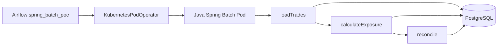

# 本地 Airflow + Kubernetes + Spring Batch POC

更新：2026-11-01（Asia/Shanghai）。**真实 Java Batch 已由 Airflow 在 Kubernetes 中执行成功；失败传播也已验证。**

## 已运行的链路



- Airflow 3.2.2，官方 Helm Chart 1.22.0；LocalExecutor + deferrable KubernetesPodOperator + triggerer。
- Docker Desktop Kubernetes v1.34.1，context 固定为 `docker-desktop`。
- Spring Boot 3.5.7 / Spring Batch 5.2.4，Java 21 容器；本地镜像 `eod-spring-batch:0.1.0`。
- PostgreSQL 16.6，持久化 Airflow metadata、Spring Batch JobRepository 和演示业务表。
- namespaces：`airflow-poc` 与 `batch-poc`。

当前 Java 项目使用镜像内的固定 CSV 样例，演示三个真实 Spring Batch Step；Exposure 使用样例公式 amount × 1.10。它还不是实际生产计算规则，也尚未接入 VM 文件或 S3。

## 打开与运行

当前访问地址：[Airflow UI](http://localhost:8080)。本地自动管理员模式，无需密码；只通过 127.0.0.1 端口转发开放，不适用于公开服务或生产环境。

在页面中选择 **spring_batch_poc**，手工 Trigger，默认参数：

```json
{"business_date":"2026-11-01","force_failure":false}
```

PowerShell 7，在仓库根目录：

```powershell
$poc = './solutions/2026-10-27-airflow-kubernetes-spring-batch-migration/poc'
& "$poc/scripts/Build-Batch.ps1"
& "$poc/scripts/Setup-Local.ps1"
& "$poc/scripts/Open-Airflow.ps1"
```

如果本机服务仍在运行，无需再次安装；端口转发停止时，仅执行 Open-Airflow.ps1，并保持窗口运行。

重新部署 DAG：

```powershell
& "$poc/scripts/Deploy-Dag.ps1"
```

自动触发并等待验证结果：

```powershell
& "$poc/scripts/Verify-Batch.ps1"
```

每次运行以 businessDate、requestId、forceFailure 标识一个 Spring Batch JobInstance。requestId 来自 Airflow run_id；同一 DAG 内继续执行使用相同参数，新一次手工触发创建新的 JobInstance。演示业务表按日期与交易/Tree 主键进行 upsert，重复正常运行不会增加重复行。生产仍需要输入/配置版本、幂等和发布协议设计。

## 本次实测结果

| 检查 | 结果 |
|---|---|
| Kubernetes 节点、CoreDNS、hostpath 存储 | 正常 |
| Airflow API server、scheduler、dag processor、triggerer | 全部 Ready |
| DAG 导入错误 | 无 |
| Maven 本机构建与 Docker 多阶段构建 | 均成功 |
| 正常 DAG `poc-1793527210` | success |
| Spring Batch JobExecution 1 | COMPLETED / COMPLETED |
| 三个正常 Step | 全部 COMPLETED |
| 业务结果 2026-11-01 | TREE-A=385.00；TREE-B=55.00 |
| 主动失败 DAG `poc-failure-check` | failed，符合预期 |
| 失败执行 | loadTrades COMPLETED；calculateExposure FAILED；未进入 reconcile |
| UI HTTP 检查 | 200 |

页面中保留的一次红色运行 `poc-failure-check` 是主动失败测试。将 force_failure 设为 true 可复现；该参数触发 Java 异常，Job 失败并通过非零退出码传给 Airflow。

查询结果：

```powershell
kubectl --context docker-desktop -n batch-poc exec deployment/eod-postgres -- psql -U airflow -d airflow -c 'SELECT * FROM spring_poc.exposures ORDER BY business_date,tree_id'
kubectl --context docker-desktop -n batch-poc exec deployment/eod-postgres -- psql -U airflow -d airflow -c 'SELECT job_execution_id,status,exit_code FROM batch_job_execution ORDER BY job_execution_id'
```

## 文件说明

| 文件/目录 | 用途 |
|---|---|
| `spring-batch/` | 完整 Java 源码、pom、固定 CSV、Dockerfile |
| `charts/eod-poc/files/spring_batch_poc.py` | 真实 Java Batch DAG |
| `charts/eod-poc/files/eod_pipeline.py` | 早期可选 S3 + Python 模拟 domain DAG，默认保持暂停 |
| `charts/eod-poc/files/worker.py` | 早期 S3 模拟程序，不是 Spring Batch |
| `charts/eod-poc/` | ConfigMap DAG 发布、业务配置、RBAC、配额、PostgreSQL、可选 MinIO |
| `airflow/values-local.yaml` | Airflow 官方 Chart 本地配置 |
| `scripts/Build-Batch.ps1` | 用 Docker 构建 Java 镜像，无需本机 Maven |
| `scripts/Setup-Local.ps1` | 部署依赖、Airflow 和包含 deferred task 的 compute Pool |
| `scripts/Deploy-Dag.ps1` | Helm 更新 DAG |
| `scripts/Open-Airflow.ps1` | 本地 UI 端口转发 |
| `scripts/Verify-Batch.ps1` | 运行真实 DAG 并检查数据库 |
| `HISTORY-2026-10-28.md` | 上一次未完成时的历史快照，不代表当前状态 |

## 已解决的问题

1. Docker Desktop 残留通信文件导致启动失败：备份临时通信目录后恢复，容器、镜像和数据未删除。
2. kubelet 内部请求误走本机代理：为启动进程设置本地 NO_PROXY，并用 WSLENV=NO_PROXY/u:no_proxy/u 传入 WSL，节点恢复 Ready。外部网络继续使用原代理。
3. ConfigMap 的内部符号链接触发 Airflow 目录循环检查：加入 `.airflowignore`，排除 `..*`，显式使用 glob 语法。
4. SimpleAuthManager 模式不需 FAB 用户创建 Job：已关闭该 Job。
5. LocalExecutor 的 scheduler 由当前 Chart 部署为 StatefulSet：脚本改为对应资源。
6. PowerShell 函数转发参数会消耗 kubectl exec 的 `--`：公共函数恢复分隔符。

## 边界与下一步

- MinIO 原选镜像目前返回访问拒绝，因此默认副本数为 0，Setup 不再 seed S3。S3 模拟 DAG 保留但没有端到端验证；接通可用对象存储后才能运行。
- Java POC 读取内置 CSV；接入 S3、文件 manifest 和跨 domain 多镜像编排为下一阶段。
- 尚未部署 Loki、Grafana、Prometheus；当前使用 Airflow task 日志和数据库执行记录。日志未配置长期远端存储。
- 当前 PostgreSQL 为方便本机演示共用实例和用户，业务数据使用 spring_poc schema。生产应分离用户、权限、可用性与恢复策略。
- 镜像 imagePullPolicy=Never 依赖本机 Docker Desktop 镜像存储。其他集群需发布到可用镜像仓库，并改为固定 digest。
- 尚未验证 EOD 峰值容量、Pod 强制终止恢复、历史数据版本重放、业务日历和生产安全配置。
- 工具、缓存、随机凭据都在根目录 `.local/`，已排除 Git；不要上传其中的 Secrets 或 kubeconfig。

官方参考：[Airflow Chart](https://airflow.apache.org/docs/helm-chart/1.22.0/)、[Spring Boot Batch](https://docs.spring.io/spring-boot/3.5/how-to/batch.html)、[Spring Batch 入门](https://spring.io/guides/gs/batch-processing)。