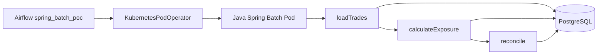

[中文](#zh) | [English](#en)

<a id="zh"></a>

# 本地 Airflow + Kubernetes + Spring Batch POC

更新：2026-11-01（Asia/Shanghai）。**真实 Java Batch 已由 Airflow 在 Kubernetes 中执行成功；失败传播也已验证。**

## 已运行的链路



- Airflow 3.2.2，官方 Helm Chart 1.22.0；LocalExecutor + deferrable KubernetesPodOperator + triggerer。
- Docker Desktop Kubernetes v1.34.1，context 固定为 `docker-desktop`。
- Spring Boot 3.5.7 / Spring Batch 5.2.4，Java 21 容器；本地镜像 `eod-spring-batch:0.1.0`。
- PostgreSQL 16.6，持久化 Airflow metadata、Spring Batch JobRepository 和演示业务表。
- namespaces：`airflow-poc`、`batch-poc` 与入口控制器使用的 `ingress-poc`。

当前 Java 项目使用镜像内的固定 CSV 样例，演示三个真实 Spring Batch Step；Exposure 使用样例公式 amount × 1.10。它还不是实际生产计算规则，也尚未接入 VM 文件或 S3。

## 打开与运行

当前固定入口：[Airflow UI](http://localhost/)。使用 Traefik Ingress，不需要运行端口转发命令。已启用 Airflow 自带登录，账号为 `poc`；随机密码仅保存在仓库根目录 `.local/ingress-credentials.json` 和 Kubernetes Secret，不上传 GitHub。

在页面中选择 **spring_batch_poc**，手工 Trigger，默认参数：

```json
{"business_date":"2026-11-01","force_failure":false}
```

PowerShell 7，在仓库根目录：

```powershell
$poc = './solutions/2026-10-27-airflow-kubernetes-spring-batch-migration/poc'
& "$poc/scripts/Build-Batch.ps1"
& "$poc/scripts/Setup-Local.ps1"
```

安装脚本已包含 Ingress 配置。服务运行时，直接打开 http://localhost/ 即可。仅为已有环境安装或更新 Ingress：

```powershell
& "$poc/scripts/Setup-Ingress.ps1"
```

查看本机登录凭据（不要将输出上传 GitHub）：

```powershell
Get-Content .local/ingress-credentials.json
```

访问链路是浏览器 → Docker Desktop LoadBalancer 的 80 端口 → Traefik → Ingress → Airflow Service → API Server Pod。相关 Deployment、Service、Ingress 和 Secret 保存在集群中；Pod 重建由 Kubernetes 恢复，不依赖 PowerShell 或 kubectl 会话。Docker Desktop 和 Kubernetes 必须处于运行状态，删除或重置集群后需要重新安装。这个本地 HTTP/SimpleAuthManager 配置不等同于生产 HTTPS/SSO。

已验证：页面 HTTP 200、原生登录 HTTP 201、带令牌的 DAG API HTTP 200、匿名 DAG API HTTP 401。Traefik 滚动重建后仍可访问；旧 8080 转发不再作为访问依赖。Open-Airflow.ps1 和 Start-AirflowUI.ps1 保留作为应急转发工具，常规访问不需要执行它们。

官方依据：[Docker Desktop 的本地 LoadBalancer](https://www.docker.com/blog/how-kubernetes-works-under-the-hood-with-docker-desktop/)、[Traefik Kubernetes 安装](https://doc.traefik.io/traefik/getting-started/quick-start-with-kubernetes/)、[Airflow SimpleAuthManager 配置](https://airflow.apache.org/docs/apache-airflow/3.2.0/configurations-ref.html)。

重新部署 DAG：

```powershell
& "$poc/scripts/Deploy-Dag.ps1"
```

自动触发并等待验证结果：

```powershell
& "$poc/scripts/Verify-Batch.ps1"
```

每次运行以 businessDate、requestId、forceFailure 标识一个 Spring Batch JobInstance。requestId 来自 Airflow run_id；同一 DAG 内继续执行使用相同参数，新一次手工触发创建新的 JobInstance。演示业务表按日期与交易/Tree 主键进行 upsert，重复正常运行不会增加重复行。生产仍需要输入/配置版本、幂等和发布协议设计。

## 本次实测结果

| 检查 | 结果 |
|---|---|
| Kubernetes 节点、CoreDNS、hostpath 存储 | 正常 |
| Airflow API server、scheduler、dag processor、triggerer | 全部 Ready |
| DAG 导入错误 | 无 |
| Maven 本机构建与 Docker 多阶段构建 | 均成功 |
| 正常 DAG `poc-1793527210` | success |
| Spring Batch JobExecution 1 | COMPLETED / COMPLETED |
| 三个正常 Step | 全部 COMPLETED |
| 业务结果 2026-11-01 | TREE-A=385.00；TREE-B=55.00 |
| 主动失败 DAG `poc-failure-check` | failed，符合预期 |
| 失败执行 | loadTrades COMPLETED；calculateExposure FAILED；未进入 reconcile |
| UI HTTP 检查 | 200 |

页面中保留的一次红色运行 `poc-failure-check` 是主动失败测试。将 force_failure 设为 true 可复现；该参数触发 Java 异常，Job 失败并通过非零退出码传给 Airflow。

查询结果：

```powershell
kubectl --context docker-desktop -n batch-poc exec deployment/eod-postgres -- psql -U airflow -d airflow -c 'SELECT * FROM spring_poc.exposures ORDER BY business_date,tree_id'
kubectl --context docker-desktop -n batch-poc exec deployment/eod-postgres -- psql -U airflow -d airflow -c 'SELECT job_execution_id,status,exit_code FROM batch_job_execution ORDER BY job_execution_id'
```

## S3 wait 修复与使用（2026-11-01）

原始异常是 `EndpointConnectionError / Connection refused`：eod-minio Service 没有后端 Pod。原 MinIO 镜像仍无法拉取，因此本地 POC 现在使用 Moto 5.1.16 官方 S3 模拟服务，镜像已固定 digest；`eod-minio` Service 名称保留以兼容现有 endpoint，实际后端为 `eod-s3mock`，并不是真正的 MinIO。

已经验证：

- 默认对象 `s3://eod-input/2026-10-26/demo-v1/manifest.json` 可从 Airflow 内部读取。
- 测试运行 `s3-wait-proof-1793531032` 先等待一个不存在的 manifest，wait_manifest 进入 deferred。
- 上传交易文件并最后发布 manifest 后，wait 恢复；wait_manifest、ingest、tree、exposure、reconcile 全部成功，DAG 为 success，四条业务阶段记录已保存。

现在在 Airflow 选择 **eod_exposure_poc**，重新 Trigger 一个新运行，使用默认参数：

```json
{"business_date":"2026-10-26","input_version":"demo-v1","config_version":"demo-config-1"}
```

旧的失败运行是历史记录，不会自动变为成功；建议新建运行，避免只清除 wait 而留下下游 upstream_failed 状态。这个 DAG 使用 Python 模拟 domain；真实 Java Batch 仍运行 spring_batch_poc，两条验证链路尚未合并。

重建服务、准备默认数据及验证真正的异步等待：

```powershell
$poc = './solutions/2026-10-27-airflow-kubernetes-spring-batch-migration/poc'
& "$poc/scripts/Deploy-Dag.ps1"
& "$poc/scripts/Seed-Demo.ps1"
& "$poc/scripts/Verify-S3.ps1"
```

Verify-S3 每次生成唯一 input_version，先确认 deferred，再上传文件并等待整条流程成功。首次安装 Setup-Local 已自动准备默认数据。

Moto 是内存中的测试模拟服务，不提供生产级持久化、权限或故障保障。Pod 重启后对象会丢失，应重新执行 Seed-Demo；PostgreSQL 中的历史记录不会因此丢失。不要把它当作生产 S3 或 MinIO 的安全和可靠性验证。如需真正 MinIO，将 s3Mock.enabled 设为 false、minio.enabled 设为 true，并提供可获取的自有镜像；Chart 禁止同时启用两种后端。

`*.svc.cluster.local` 是集群内部地址，不能在电脑浏览器直接打开；复制路径时去掉尾部双引号。若只想在电脑上查看本地模拟服务，可另开窗口运行下列转发，再访问 http://localhost:9000/eod-input/2026-10-26/demo-v1/manifest.json 。该访问不代表生产认证行为。

```powershell
kubectl --context docker-desktop -n batch-poc port-forward --address 127.0.0.1 service/eod-minio 9000:9000
```

Moto 部署方式参考[官方 Server Mode 文档](https://docs.getmoto.org/en/5.1.3/docs/server_mode.html)。

## 文件说明

| 文件/目录 | 用途 |
|---|---|
| `spring-batch/` | 完整 Java 源码、pom、固定 CSV、Dockerfile |
| `charts/eod-poc/files/spring_batch_poc.py` | 真实 Java Batch DAG |
| `charts/eod-poc/files/eod_pipeline.py` | 已验证的 S3 + Python 模拟 domain DAG |
| `charts/eod-poc/files/worker.py` | 早期 S3 模拟程序，不是 Spring Batch |
| `charts/eod-poc/` | ConfigMap DAG 发布、业务配置、RBAC、配额、PostgreSQL、Moto S3、可选 MinIO |
| `airflow/values-local.yaml` | Airflow 官方 Chart 本地配置 |
| `scripts/Build-Batch.ps1` | 用 Docker 构建 Java 镜像，无需本机 Maven |
| `scripts/Setup-Local.ps1` | 部署依赖、Airflow 和包含 deferred task 的 compute Pool |
| `scripts/Deploy-Dag.ps1` | Helm 更新 DAG |
| `scripts/Open-Airflow.ps1` | 应急 UI 端口转发 |
| `scripts/Setup-Ingress.ps1` | 安装固定 Ingress 入口并启用原生登录 |
| `scripts/Initialize-AirflowAccess.ps1` | 初始化或复用本地访问凭据并写入 Secret |
| `ingress/values-traefik.yaml`、`charts/airflow-ingress/` | 入口控制器和 Ingress 路由配置 |
| `scripts/Start-AirflowUI.ps1` | 后台启动 UI 转发并验证 HTTP 200 |
| `scripts/Verify-Batch.ps1` | 运行真实 DAG 并检查数据库 |
| `scripts/Verify-S3.ps1` | 验证缺文件等待、上传后恢复及 S3/Python 完整链路 |
| `HISTORY-2026-10-28.md` | 上一次未完成时的历史快照，不代表当前状态 |

## 已解决的问题

1. Docker Desktop 残留通信文件导致启动失败：备份临时通信目录后恢复，容器、镜像和数据未删除。
2. kubelet 内部请求误走本机代理：为启动进程设置本地 NO_PROXY，并用 WSLENV=NO_PROXY/u:no_proxy/u 传入 WSL，节点恢复 Ready。外部网络继续使用原代理。
3. ConfigMap 的内部符号链接触发 Airflow 目录循环检查：加入 `.airflowignore`，排除 `..*`，显式使用 glob 语法。
4. SimpleAuthManager 模式不需 FAB 用户创建 Job：已关闭该 Job。
5. LocalExecutor 的 scheduler 由当前 Chart 部署为 StatefulSet：脚本改为对应资源。
6. PowerShell 函数转发参数会消耗 kubectl exec 的 `--`：公共函数恢复分隔符。

## 边界与下一步

- 原 MinIO 镜像仍不可获取，默认使用内存型 Moto S3 模拟服务，已验证 S3/Python 链路；它不能代替生产对象存储。
- Java POC 读取内置 CSV；接入 S3、文件 manifest 和跨 domain 多镜像编排为下一阶段。
- 尚未部署 Loki、Grafana、Prometheus；当前使用 Airflow task 日志和数据库执行记录。日志未配置长期远端存储。
- 当前 PostgreSQL 为方便本机演示共用实例和用户，业务数据使用 spring_poc schema。生产应分离用户、权限、可用性与恢复策略。
- 镜像 imagePullPolicy=Never 依赖本机 Docker Desktop 镜像存储。其他集群需发布到可用镜像仓库，并改为固定 digest。
- 尚未验证 EOD 峰值容量、Pod 强制终止恢复、历史数据版本重放、业务日历和生产安全配置。
- 工具、缓存、随机凭据都在根目录 `.local/`，已排除 Git；不要上传其中的 Secrets 或 kubeconfig。

官方参考：[Airflow Chart](https://airflow.apache.org/docs/helm-chart/1.22.0/)、[Spring Boot Batch](https://docs.spring.io/spring-boot/3.5/how-to/batch.html)、[Spring Batch 入门](https://spring.io/guides/gs/batch-processing)。

---

<a id="en"></a>

# Local Airflow + Kubernetes + Spring Batch POC — English

Updated: 2026-11-01 (Asia/Shanghai). **Airflow has successfully executed a real Java Batch application on Kubernetes. Failure propagation has also been verified.**

## Executed pipeline


- Airflow 3.2.2, official Helm chart 1.22.0; LocalExecutor, deferrable KubernetesPodOperator, and triggerer.
- Docker Desktop Kubernetes v1.34.1; scripts explicitly target context `docker-desktop`.
- Spring Boot 3.5.7 / Spring Batch 5.2.4, Java 21 container, local image `eod-spring-batch:0.1.0`.
- PostgreSQL 16.6 persists Airflow metadata, the Spring Batch JobRepository, and demo business tables.
- Namespaces: `airflow-poc`, `batch-poc`, and `ingress-poc` for the controller.

The Java project reads a fixed CSV fixture bundled in its image and executes three real Spring Batch steps. The demo exposure formula is amount × 1.10. Production calculation rules, VM files, and S3 are not yet integrated.

## Open and run

Persistent entry: [Airflow UI](http://localhost/), served through Traefik Ingress without a port-forward process. Airflow native login is enabled with username `poc`; the random password is stored only in the repository-root `.local/ingress-credentials.json` and a Kubernetes Secret, not GitHub.

Choose **spring_batch_poc** and trigger it manually with the defaults:

```json
{"business_date":"2026-11-01","force_failure":false}
```

From the repository root in PowerShell 7:

```powershell
$poc = './solutions/2026-10-27-airflow-kubernetes-spring-batch-migration/poc'
& "$poc/scripts/Build-Batch.ps1"
& "$poc/scripts/Setup-Local.ps1"
```

Setup now includes Ingress installation. While services are running, simply open http://localhost/. To install or update Ingress in an existing environment:

```powershell
& "$poc/scripts/Setup-Ingress.ps1"
```

Read the local login credentials (do not upload this output to GitHub):

```powershell
Get-Content .local/ingress-credentials.json
```

Traffic flows from the browser through Docker Desktop's LoadBalancer on port 80, Traefik, Ingress, the Airflow Service, and the API Server Pod. Deployments, Services, Ingress, and Secrets persist in the cluster; Kubernetes recreates Pods without a PowerShell or kubectl session. Docker Desktop and Kubernetes must be running. Deleting/resetting the cluster requires reinstallation. This local HTTP/SimpleAuthManager setup is not production HTTPS/SSO.

Verified: homepage HTTP 200, native login HTTP 201, authenticated DAG API HTTP 200, and anonymous DAG API HTTP 401. Access survived a Traefik rolling rebuild and no longer depends on the old 8080 forward. Open-Airflow.ps1 and Start-AirflowUI.ps1 remain emergency forwarding tools; neither is needed for normal access.

Official references: [Docker Desktop local LoadBalancer](https://www.docker.com/blog/how-kubernetes-works-under-the-hood-with-docker-desktop/), [Traefik Kubernetes setup](https://doc.traefik.io/traefik/getting-started/quick-start-with-kubernetes/), [Airflow SimpleAuthManager settings](https://airflow.apache.org/docs/apache-airflow/3.2.0/configurations-ref.html).

Redeploy the DAG:

```powershell
& "$poc/scripts/Deploy-Dag.ps1"
```

Trigger a run and wait for verification:

```powershell
& "$poc/scripts/Verify-Batch.ps1"
```

A Spring Batch JobInstance is identified by businessDate, requestId, and forceFailure. requestId comes from the Airflow run_id. Continuing the same DAG run uses the same parameters; a new manual trigger creates a new JobInstance. Demo business rows are upserted using business date and trade/Tree keys, so repeated normal runs do not add duplicate rows. Production still requires input/configuration versioning, idempotency, and publication protocols.

## Observed verification results

| Check | Result |
|---|---|
| Kubernetes node, CoreDNS, hostpath storage | Healthy |
| Airflow API server, scheduler, DAG processor, triggerer | All Ready |
| DAG import errors | None |
| Local Maven build and Docker multistage build | Both succeeded |
| Normal DAG run `poc-1793527210` | success |
| Spring Batch JobExecution 1 | COMPLETED / COMPLETED |
| Three steps in the normal execution | All COMPLETED |
| Business results for 2026-11-01 | TREE-A=385.00; TREE-B=55.00 |
| Intentional failure run `poc-failure-check` | failed, as expected |
| Failed execution | loadTrades COMPLETED; calculateExposure FAILED; reconcile was not entered |
| UI HTTP check | 200 |

The red run `poc-failure-check` retained in the UI is intentional. Set force_failure to true to reproduce it: Java throws an exception, the Job fails, and a nonzero process exit code propagates the failure to Airflow.

Query the results:

```powershell
kubectl --context docker-desktop -n batch-poc exec deployment/eod-postgres -- psql -U airflow -d airflow -c 'SELECT * FROM spring_poc.exposures ORDER BY business_date,tree_id'
kubectl --context docker-desktop -n batch-poc exec deployment/eod-postgres -- psql -U airflow -d airflow -c 'SELECT job_execution_id,status,exit_code FROM batch_job_execution ORDER BY job_execution_id'
```

## S3 wait repair and usage (2026-11-01)

The original exception was `EndpointConnectionError / Connection refused`: eod-minio had no backend Pod. The original MinIO image remains unavailable, so this local POC now uses the official Moto 5.1.16 S3 simulator, pinned by image digest. The eod-minio Service name is retained for endpoint compatibility, but its backend is eod-s3mock, not an actual MinIO server.

Verified:

- Airflow can read the default object s3://eod-input/2026-10-26/demo-v1/manifest.json.
- Run s3-wait-proof-1793531032 initially waited for a missing manifest; wait_manifest entered deferred.
- After uploading trades and publishing the manifest last, the Sensor resumed. wait_manifest, ingest, tree, exposure, and reconcile all succeeded; the DAG reached success and all four business-stage records were persisted.

In Airflow, select **eod_exposure_poc**, create a new triggered run, and use the defaults:

```json
{"business_date":"2026-10-26","input_version":"demo-v1","config_version":"demo-config-1"}
```

Historical failed runs do not automatically become successful. Prefer a new run rather than clearing only wait while leaving downstream upstream_failed tasks. This DAG simulates domains in Python; spring_batch_poc remains the real Java application. The two verified pipelines are not yet integrated.

Recreate the service, prepare default data, and verify genuine asynchronous waiting:

```powershell
$poc = './solutions/2026-10-27-airflow-kubernetes-spring-batch-migration/poc'
& "$poc/scripts/Deploy-Dag.ps1"
& "$poc/scripts/Seed-Demo.ps1"
& "$poc/scripts/Verify-S3.ps1"
```

Verify-S3 generates a unique input_version, checks deferred status before uploading, and waits for the whole pipeline to succeed. Setup-Local now seeds the default data automatically on initial installation.

Moto is an in-memory test simulator, without production durability, permissions, or availability guarantees. Objects disappear after its Pod restarts; rerun Seed-Demo. PostgreSQL history survives that restart. This does not validate production S3/MinIO security or reliability. To use actual MinIO, disable s3Mock.enabled, enable minio.enabled, and supply an accessible image. The chart rejects enabling both backends.

The *.svc.cluster.local address is internal to Kubernetes and cannot be opened directly from a workstation browser. Remove trailing quotes from copied paths. To inspect the local mock from the workstation, run the following in another window, then open http://localhost:9000/eod-input/2026-10-26/demo-v1/manifest.json . This access does not represent production authentication behavior.

```powershell
kubectl --context docker-desktop -n batch-poc port-forward --address 127.0.0.1 service/eod-minio 9000:9000
```

See the [official Moto Server Mode documentation](https://docs.getmoto.org/en/5.1.3/docs/server_mode.html) for the deployment mechanism.

## Files

| File/directory | Purpose |
|---|---|
| `spring-batch/` | Complete Java source, pom, CSV fixture, and Dockerfile |
| `charts/eod-poc/files/spring_batch_poc.py` | Real Java Batch DAG |
| `charts/eod-poc/files/eod_pipeline.py` | Verified S3/Python domain simulation |
| `charts/eod-poc/files/worker.py` | Earlier S3 simulation, not Spring Batch |
| `charts/eod-poc/` | ConfigMap DAG publication, business configuration, RBAC, quotas, PostgreSQL, Moto S3, optional MinIO |
| `airflow/values-local.yaml` | Local settings for the official Airflow chart |
| `scripts/Build-Batch.ps1` | Builds the Java image with Docker; local Maven is unnecessary |
| `scripts/Setup-Local.ps1` | Deploys dependencies, Airflow, and a compute Pool that counts deferred tasks |
| `scripts/Deploy-Dag.ps1` | Updates DAGs through Helm |
| `scripts/Open-Airflow.ps1` | Emergency UI port forwarding |
| `scripts/Setup-Ingress.ps1` | Installs persistent Ingress and enables native login |
| `scripts/Initialize-AirflowAccess.ps1` | Initializes/reuses local credentials and writes the Secret |
| `ingress/values-traefik.yaml`, `charts/airflow-ingress/` | Controller and Ingress route configuration |
| `scripts/Start-AirflowUI.ps1` | Starts a background UI forward and verifies HTTP 200 |
| `scripts/Verify-Batch.ps1` | Executes the real DAG and checks PostgreSQL |
| `scripts/Verify-S3.ps1` | Verifies missing-file deferral, resume after upload, and the full S3/Python pipeline |
| `HISTORY-2026-10-28.md` | Historical incomplete checkpoint, not the current state |

## Resolved issues

1. Stale Docker Desktop communication files prevented startup. Backing up the temporary communication directories restored startup without deleting containers, images, or data.
2. kubelet sent internal requests to the workstation proxy. Local NO_PROXY settings were passed to WSL using WSLENV=NO_PROXY/u:no_proxy/u; the node became Ready. External requests retain the existing proxy.
3. ConfigMap internal symlinks triggered Airflow's directory-loop detection. `.airflowignore` now excludes `..*` with glob syntax explicitly enabled.
4. The FAB user-creation Job is disabled because this POC uses SimpleAuthManager.
5. This chart deploys the LocalExecutor scheduler as a StatefulSet; scripts target that resource.
6. PowerShell consumes a bare `--` forwarded through a function. The shared helper restores kubectl exec's command separator.

## Limits and next steps

- The original MinIO image remains unavailable. The default in-memory Moto S3 simulator now supports the verified S3/Python pipeline; it is not a production object store.
- The Java POC reads bundled CSV. S3 integration, file manifests, and multiple domain images are future work.
- Loki, Grafana, and Prometheus are not deployed. Current evidence uses Airflow task logs and database records; durable remote log storage is not configured.
- For local convenience, PostgreSQL shares an instance and user; business data uses schema spring_poc. Production needs separated permissions, availability, and recovery policies.
- imagePullPolicy=Never depends on the local Docker Desktop image store. Other clusters require publishing the image to an accessible registry and pinning a digest.
- EOD peak capacity, forced Pod termination/recovery, historical version replay, business calendars, and production security settings are not yet verified.
- Tools, caches, and generated credentials live in the root `.local/` directory, which Git ignores. Do not upload its Secrets or kubeconfig.

Official references: [Airflow chart](https://airflow.apache.org/docs/helm-chart/1.22.0/), [Spring Boot Batch](https://docs.spring.io/spring-boot/3.5/how-to/batch.html), [Spring Batch guide](https://spring.io/guides/gs/batch-processing).
