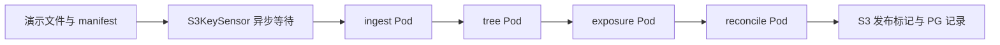

# 本地 Kubernetes + Airflow EOD POC（进行中）

进度保存日期：2026-10-28（Asia/Shanghai）。用户要求先上传当前工作，后续继续安装与联调。

**当前状态：已完成部署文件与 DAG 初稿、静态检查；Airflow 尚未安装成功，DAG 尚未端到端运行。以下脚本仍需在集群恢复后联调。**

## 已完成的文件

| 路径 | 用途 |
|---|---|
| `airflow/values-local.yaml` | 官方 Airflow Chart 的本地配置：LocalExecutor、triggerer、DAG 挂载、资源请求和 Secret 引用 |
| `charts/eod-poc/` | 自定义 Helm Chart，部署 DAG ConfigMap、模拟处理脚本、domain 配置、RBAC、ResourceQuota、PostgreSQL、MinIO 与 PVC |
| `charts/eod-poc/files/eod_pipeline.py` | `eod_exposure_poc` DAG |
| `charts/eod-poc/files/worker.py` | 可操作 S3 / PostgreSQL 的模拟 domain 程序 |
| `scripts/Setup-Local.ps1` | 环境检查、Helm 下载校验、生成本地随机凭据、部署两个 release、创建 Pool、导入演示文件 |
| `scripts/Deploy-Dag.ps1` | 通过 Helm 更新 DAG 和相关业务配置 |
| `scripts/Seed-Demo.ps1` | 生成演示 CSV，上传后最后发布 manifest |
| `scripts/Open-Airflow.ps1` | 仅绑定 127.0.0.1 的 Airflow UI 端口转发 |
| `scripts/Common.ps1` | 路径、固定 context、局部代理排除、命令错误检查 |

## 设计



- `S3KeySensor(deferrable=True)` 等待明确业务日期和输入版本的 manifest。
- 四个处理阶段使用 `KubernetesPodOperator(deferrable=True)`，受 `eod_compute` Pool、Pod requests/limits 和 namespace quota 约束。
- `eod_compute` 计划设置 2 个槽，并将 deferred task 计入占用。
- domain 数据通过固定 S3 key 传递；运行参数包含业务日期、输入版本、配置版本。
- 模拟程序校验输入 checksum / 行数，使用 Decimal 计算演示值；PG 唯一键与事务级 advisory lock 防止同一身份并发写入不同结果。
- 无 XCom 数据副本，也不需要 XCom sidecar。
- DAG 默认手工触发，`catchup=False`、`max_active_runs=1`；尚未配置生产 EOD 日历。

这是一条编排与容器执行的演示。`worker.py` **不是 Spring Batch**，Exposure 公式和对账值仅是固定样例。实际 Java 应用、JDBC JobRepository、VM 接入 Agent、Loki / Prometheus 尚未实现或部署。

## 本机已确认的信息

- Windows 11，约 16 GB 物理内存。
- Docker Desktop 4.49.0 / Docker Engine 28.5.1 已安装。
- 已有 `docker-desktop` Kubernetes context；节点版本 v1.34.1。
- 容器引擎已恢复启动，报告可用内存约 7.9 GB。
- 已下载并核验 Helm v3.19.0，工具存放于仓库根目录 `.local/tools/helm/windows-amd64/helm.exe`。
- 官方 Airflow Chart 锁定 1.22.0，Airflow 镜像锁定 `apache/airflow:3.2.2`。
- PostgreSQL 镜像为 `postgres:16.6-alpine`；MinIO 镜像为 `minio/minio:RELEASE.2025-04-22T22-12-26Z`。镜像下载未全部完成。

## 当前阻塞与诊断记录

1. Docker 最初因残留通信文件 `Docker/run/dockerInference` 与 `docker-secrets-engine/engine.sock` 无法启动。对应临时目录已改名备份，未删除容器、镜像或磁盘数据；容器引擎随后恢复。
2. 本机存在网络代理。Kubernetes 内部请求曾错误地发往代理，kubelet 报 `proxyconnect` 错误，节点状态为 `NotReady / Kubelet stopped posting node status`。
3. 已尝试在启动进程环境中增加本地地址 `NO_PROXY`，但**尚未确认规则被 kubelet 继承，也未确认节点恢复 Ready**。
4. Docker 普通重启曾再次遇到残留套接字问题，需要继续检查 Docker Desktop / WSL 的启动与代理行为。不要通过恢复出厂设置删除已有环境。
5. 镜像下载曾出现 EOF，重试后部分层开始下载。尚未确认全部镜像存在，也未运行 Airflow 镜像验证依赖。

本次没有修改系统级代理设置。脚本仅对自身进程的本地集群地址设置代理排除；外部网络继续使用原配置。

## 已通过与未通过的检查

已通过：

- 自定义 `eod-poc` Chart 的 `helm lint` 和模板渲染。
- 官方 Airflow Chart 配置曾发现 `env.valueFrom` schema 不支持，已改用 `extraEnvFrom`；修改后模板渲染通过。
- PowerShell 脚本语法解析通过。
- 两个 Python 文件的 AST 语法解析通过。
- 官方 Helm 二进制 SHA256 校验通过。

未验证：

- Airflow 镜像中 Amazon / Kubernetes provider、boto3、psycopg2 的实际版本与可用性。
- 最后补充的 Secret 名称配置与 Secret key 对应关系。
- DAG 导入、Pool CLI 参数、deferrable KPO 的 RBAC 与日志行为。
- PostgreSQL / MinIO 健康、PVC 绑定、跨 namespace DNS 和凭据。
- 模拟文件完整链路、重复运行幂等性、失败重试、资源配额和恢复场景。
- UI 访问、日志长期保存及生产认证。

## 集群恢复后的运行步骤

在仓库根目录使用 PowerShell 7。脚本固定使用 `docker-desktop` context、`airflow-poc` 与 `batch-poc` namespaces，不隐式使用当前 context。

```powershell
$poc = './solutions/2026-10-27-airflow-kubernetes-spring-batch-migration/poc'
& "$poc/scripts/Setup-Local.ps1"
& "$poc/scripts/Open-Airflow.ps1"
```

打开 `http://localhost:8080`，查找 `eod_exposure_poc`，先以默认参数手工触发：

```json
{"business_date":"2026-10-26","input_version":"demo-v1","config_version":"demo-config-1"}
```

本地认证配置采用自动管理员访问，服务仅通过 loopback 端口转发访问；不得直接作为生产部署配置。不要将 API Service 改成对外公开入口后继续使用此认证方式。

更新 DAG 后：

```powershell
& "$poc/scripts/Deploy-Dag.ps1"
```

重新准备演示输入：

```powershell
& "$poc/scripts/Seed-Demo.ps1" -BusinessDate '2026-10-26' -InputVersion 'demo-v1'
```

预期结果为 `TREE-A=385.00`、`TREE-B=55.00`；发布文件位于 `eod-output/2026-10-26/demo-v1/demo-config-1/published.json`，PG 表为 `eod_demo.stage_results`。这些是预期值，尚未实测。

## 本地文件与凭据

`.local/` 已被根目录 `.gitignore` 排除，存放工具、下载缓存、渲染结果及安装时生成的随机凭据。不要上传 `.local/eod-secrets.json`、kubeconfig 或任何生成的 Kubernetes Secret。

目前未运行到随机凭据生成和部署阶段。重新执行安装会复用该本地凭据文件（如已存在），避免密码漂移。

POC 为节约本机资源，Airflow metadata 和演示业务表暂用同一个 PostgreSQL 实例及用户，以 schema 区分。生产需要分离权限和故障影响。演示程序没有实现跨对象存储与数据库的分布式事务，不代表端到端 exactly-once 保证。

## 下一次继续工作

1. 优先确认 Docker 引擎稳定、kubelet 代理排除生效、节点 Ready、CoreDNS 和 hostpath provisioner 正常。
2. 完成三个镜像下载，验证 Airflow provider / Python 依赖；如需自定义镜像，使用 Airflow 官方 constraints 锁定依赖。
3. 重新渲染最新 Airflow values，核对 Secret 引用及 key，运行安装脚本。
4. 检查 DAG import errors、Pool 的 deferred 占用设置和跨 namespace RBAC。
5. 执行完整演示、重复输入、失败恢复，再记录实际版本、日志和结果。
6. 替换真实 Spring Batch 镜像，再增加 VM 接入、生产日历、监控及容量测试。

## 官方参考

- [Airflow 官方 Helm Chart](https://airflow.apache.org/docs/helm-chart/1.22.0/)
- [Airflow Chart 参数](https://airflow.apache.org/docs/helm-chart/1.22.0/parameters-ref.html)
- [KubernetesPodOperator](https://airflow.apache.org/docs/apache-airflow-providers-cncf-kubernetes/stable/operators.html)
- [S3 Sensor](https://airflow.apache.org/docs/apache-airflow-providers-amazon/stable/operators/s3/s3.html)
